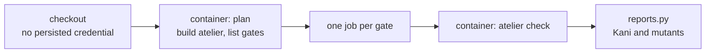

# Contained CI gates

`gates.yml` runs atelier's planner and every gate inside a fresh Linux
container on a GitHub-hosted runner, and no gate runs on a developer machine.
The packaging and docs workflows build on the runner itself; they run no
test, Kani proof or mutant.



| File              | Holds                                                                             |
| ----------------- | --------------------------------------------------------------------------------- |
| `run.sh`          | The runner-side launcher; refuses to run outside GitHub-hosted Linux              |
| `Dockerfile`      | Tooling only: Rust, Node, Go, Python and pipx, with user 10001                    |
| `entrypoint.sh`   | Copies the read-only checkout into the container, then plans or checks            |
| `cargo.py`        | A `cargo` front that exports Kani's JSON and never leaves mutation evidence empty |
| `reports.py`      | Fail-closed validation of fresh Kani and cargo-mutants reports                    |
| `test_reports.py` | The validator's own tests, run before every plan                                  |

## The container

```sh
bash "$CI_SUPPORT/run.sh" gate commands/mutants . "$BASE"
```

Each container runs as user `10001` with its own PID namespace, all
capabilities dropped, `no-new-privileges`, 4,096 processes and threads, the
runner's memory less 2 GiB with no swap beyond it, its CPUs less one, and a
75-minute limit. It uses Docker's
bridge network, never the host's, so setup commands can install pinned tools.
It has no Docker socket, runner home, runner command files or token: the
checkout is mounted read-only after `actions/checkout` drops its credential,
and the release download that needs `GH_TOKEN` runs before, without project
code. A private repository's `origin` fetch therefore needs a public clone or
a future read-only mirror; atelier itself is public.

The gate definitions still come from `origin`'s default branch, as
[slice 2](../../docs/plans/slices/slice-2.md) describes. The CI support files
come from the commit of the reusable workflow (`job.workflow_sha`). A
project pins that commit in its `atelier.yml`; atelier's own CI calls the
workflow from the same commit, so its pull requests are reviewed with the
containment they change.

## Reports

A gate passes only when `atelier check` exits 0 and its report is valid.

- **Kani:** `ci-reports/kani.json` from Kani 0.68.0 lists both proofs in
  `machine::proofs`, each successful, with matching property counts.
- **Mutants:** `mutants.out/outcomes.json` from cargo-mutants 27.1.0 has a
  finished run, a successful baseline, at least one mutant, and no missed,
  timed-out or failed mutant. Unviable mutants keep their existing meaning.

When a diff selects no mutant, as on a push to `main` or a docs-only change,
`cargo.py` mutates `crates/cli/src/command_step/run.rs`, the signal
boundary of the host incident, so the report is never empty and the run stays
within the gate's hour. Every report is
uploaded as an artifact, also when the gate fails.

Linux containers do not prove Darwin's process-group signalling. That needs a
separately approved disposable macOS environment.
