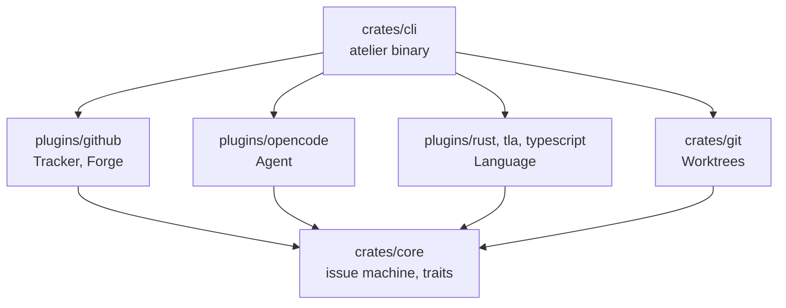
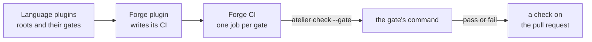
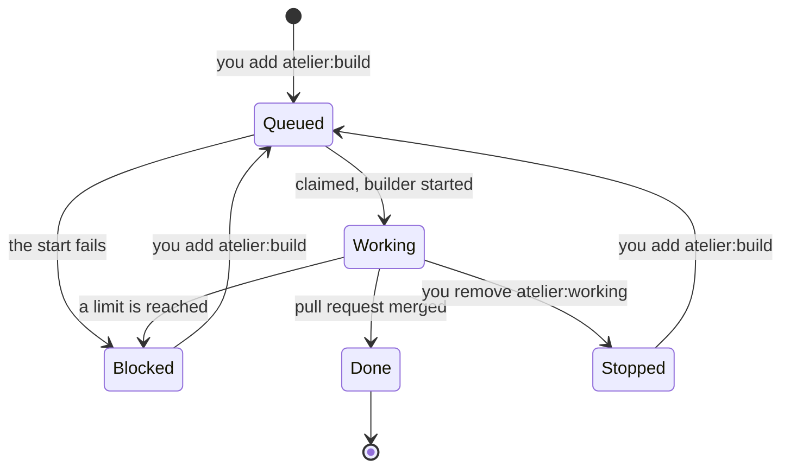

# atelier

A personal software factory. You plan a feature as a GitHub issue and add the
`atelier:build` label. atelier starts a builder agent in its own worktree, which
opens a pull request and works until every check passes, a critic agent finds
nothing blocking, and a recording shows the feature working. Then the pull request
is yours to review.

```sh
atelier init                         # in a project: labels and .atelier/config.toml
atelier add StevenJPx2/chauffeur     # watch it
brew services start atelier          # keep its daemon running
gh issue edit 12 --add-label atelier:build
```

## How a feature moves


The checks decide when the work is done. The agent does not judge it, and no
rulebook or skill has to be followed: a builder knows its issue, the project's
`AGENTS.md` and the contract in [`prompts/builder.md`](prompts/builder.md).

## A core and its plugins

The core is the issue machine and the agent orchestrator: it sees issues, decides
what happens to each (claim, start, stop, block, close), and starts an agent as the
project's config says. It knows no programming language, issue tracker, forge or
agent. Plugins do, each a Rust crate in this repository, compiled into the one
`atelier` binary. Each plugin registers the kinds it provides: `plugins/github`
is both a tracker and the forge. A project has one forge and one agent, and any
number of trackers, such as GitHub and Jira together, each with its own filter.



| Kind     | Does                                     | Plugins                     |
| -------- | ---------------------------------------- | --------------------------- |
| Tracker  | Finds, marks and closes issues           | `github`                    |
| Forge    | Pull requests, checks, how CI runs gates | `github`                    |
| Agent    | Starts and stops builders and critics    | `opencode`                  |
| Language | Finds its roots; names their gates       | `rust`, `tla`, `typescript` |

Every plugin lives in this repository and ships in the release; atelier loads no
code at run time.

## Gates

atelier finds a project's languages, and where each lives, by itself. Each language
plugin finds its roots, the directories its gates run in, so one repository can
hold Rust in one directory and TLA+ specs in another, each with its own gates.
Language plugins name the gates; the forge plugin defines how its CI runs them.



```text
.      rust/clippy     pass    21 s
.      rust/mutants    pass   130 s   14 mutants in the diff, 14 caught
specs  tla/tlc         pass     3 s   tick.tla
```

On a pull request, CI runs the gates of each root the diff touches. The builder
never runs them: a failed gate reaches it as a failed check, through sourcefed.

- **rust**: a root is a Cargo workspace or a crate outside one. fmt, Clippy with
  `-D warnings`, nextest, doc tests, cargo-mutants on the pull request's diff
  (`--in-diff`), and Kani when a crate has proofs.
- **tla**: a root is a directory with `*.tla` specs. TLC on each, in a project of
  any language.
- **typescript**: a root is an npm, Bun or pnpm workspace, or a package outside
  one. Its `check` script when it has one, as sourcefed's `npm run check`;
  otherwise `tsc --noEmit` and its `build` and `test` scripts.

## An issue's states

Labels hold the state, so an issue shows where its feature is.



| Label             | Set by  | Means                                            |
| ----------------- | ------- | ------------------------------------------------ |
| `atelier:build`   | You     | Start a builder on this issue                    |
| `atelier:working` | atelier | A builder holds it; a second one never starts    |
| `atelier:blocked` | Builder | It stopped; the pull request says what blocks it |
| `improvement`     | Critic  | A finding that does not block, kept for later    |

A builder that starts again on a blocked or stopped issue continues on the same
branch and pull request.

## What lives where

| atelier holds              | A project holds                                 |
| -------------------------- | ----------------------------------------------- |
| Core, plugins, CLI         | `.atelier/config.toml`: only what differs       |
| Builder and critic prompts | `AGENTS.md`: how to build, test and record it   |
| `gates.yml`, from `github` | `.github/workflows/atelier.yml`, which calls it |
| The pull request template  |                                                 |

Every setting has a default found from the project: the base is the forge's
default branch, the tracker and forge come from the `origin` remote, and the
languages from their roots. The config holds only what differs. Chauffeur's is one
line; another project might take only some issues, or turn checks off under a
path:

```toml
# .atelier/config.toml
base = "v2"

[filter]
labels = ["backend"] # atelier:build issues also labelled backend

[limits]
red_rounds = 5      # failed CI rounds before the builder stops, the default

[paths."vendor"]
languages = []      # nothing under vendor/ is checked
```

A filter narrows which `atelier:build` issues atelier takes, by `assignee`,
`author`, `labels` or the tracker's own query. Each tracker, listed as
`[[tracker]]`, has its own. Your own filters in `~/.config/atelier/projects.toml`,
one for each tracker, such as `assignee`, narrow them to your issues.

## Pull requests

Every pull request has the same sections, and a check fails when one is empty:

- **You can**: what a person can do once it merges.
- **Diagram**: Mermaid, checked to parse.
- **Recording**: a GIF that links to the video on R2.
- **Proofs**: each proof, what it covers, its result.
- **Gates**: the checks that ran.
- **Critic**: each finding, fixed or answered.

## Limits

Each loop ends. After `red_rounds` failed CI rounds or `critic_rounds` reviews,
the builder comments on the pull request with what blocks it, labels the issue
`atelier:blocked` and stops. The daemon checks the same counts and stops a
builder that does not.

## Building atelier

atelier is built by atelier, one slice at a time. Its plan is
[issue #1](https://github.com/StevenJPx2/atelier/issues/1).
