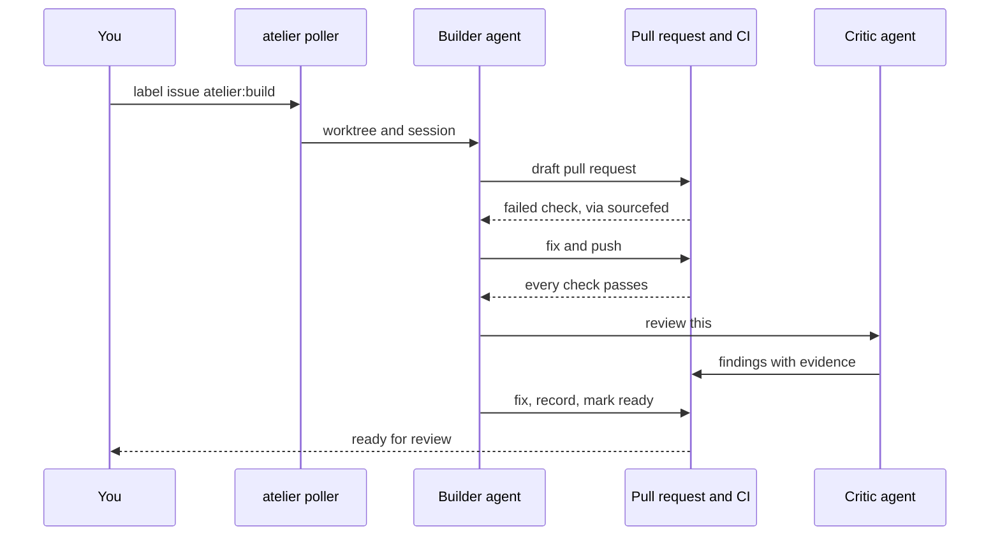
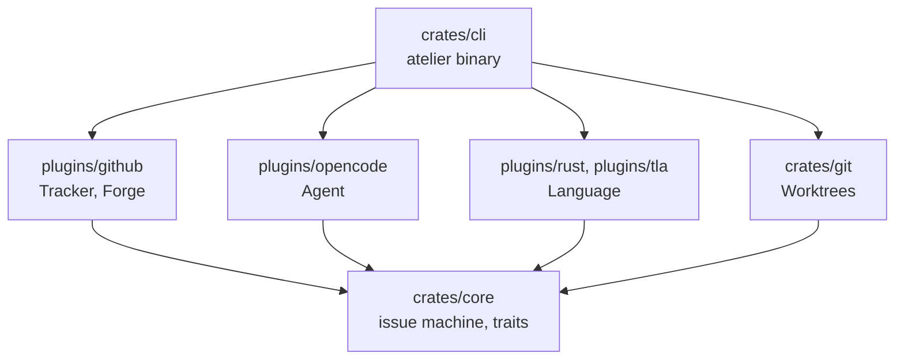
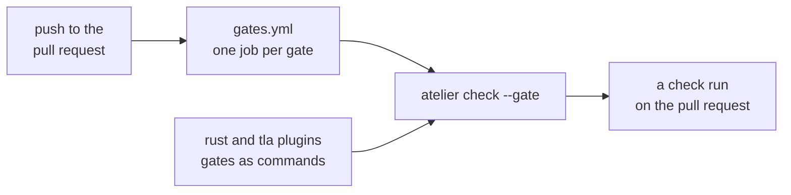
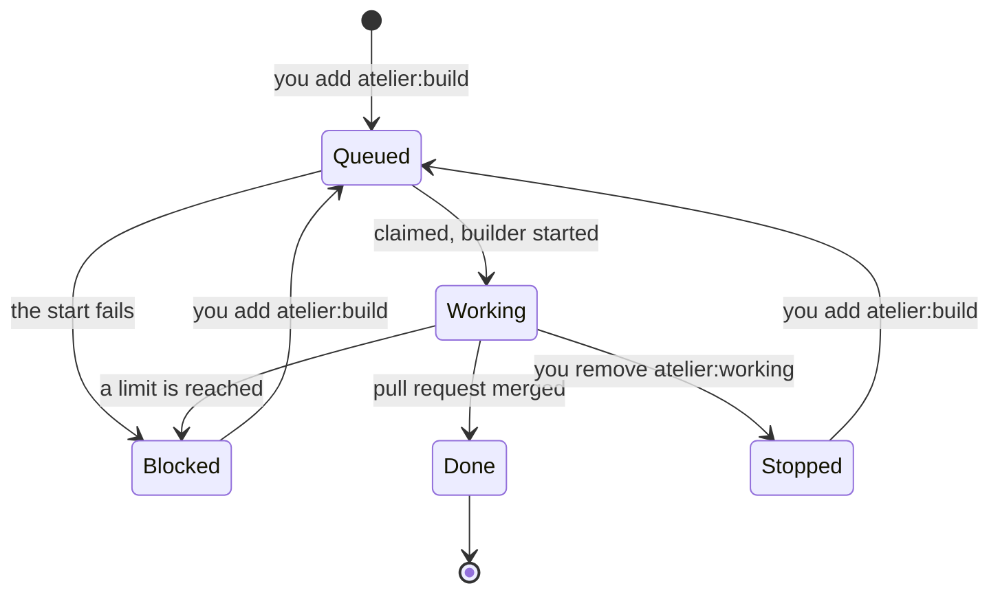

# atelier

A personal software factory. You plan a feature as a GitHub issue and add the
`atelier:build` label. atelier starts a builder agent in its own worktree, which
opens a pull request and works until every check passes, a critic agent finds
nothing blocking, and a recording shows the feature working. Then the pull request
is yours to review.

```sh
atelier init                         # in a project: labels and .atelier/config.toml
atelier add StevenJPx2/chauffeur     # watch it
brew services start atelier          # poll every minute
gh issue edit 12 --add-label atelier:build
```

## How a feature moves



The checks decide when the work is done. The agent does not judge it, and no
rulebook or skill has to be followed: a builder knows its issue, the project's
`AGENTS.md` and the contract in [`prompts/builder.md`](prompts/builder.md).

## A core and its plugins

The core is the issue machine and the agent orchestrator: it sees issues, decides
what happens to each (claim, start, stop, block, close), and starts an agent as the
project's config says. It knows no programming language, issue tracker, forge or
agent. Plugins do, each a Rust crate in this repository, compiled into the one
`atelier` binary. Each plugin registers the kinds it provides: `plugins/github`
is both the tracker and the forge, and a project with its issues in Jira pairs a
`jira` tracker with the `github` forge.



| Kind     | Does                                           | Plugins       |
| -------- | ---------------------------------------------- | ------------- |
| Tracker  | Finds, reads, marks and closes issues          | `github`      |
| Forge    | Pull requests, checks, and how gates run in CI | `github`      |
| Agent    | Starts and stops a builder or critic session   | `opencode`    |
| Language | Finds itself in a project; names its gates     | `rust`, `tla` |

An external plugin is named by `owner/repo@sha` and joins the binary as a pinned
Git dependency of this workspace, reviewed and released like any other. atelier
loads no code at run time.

## Gates

Language plugins name the gates; the forge plugin defines how they run in its CI.
On GitHub, on every push to a pull request, `gates.yml` runs `atelier check` once
per gate of the project's languages, each as its own check. The builder never
runs them: a failed gate reaches it as a failed check, through sourcefed.



- **rust**: fmt, Clippy with `-D warnings`, nextest, doc tests, cargo-mutants on
  the pull request's diff (`--in-diff`), and Kani when a crate has proofs.
- **tla**: TLC on each `*.tla` spec, in a project of any language.

## An issue's states

Labels hold the state, so an issue shows where its feature is.



| Label             | Set by  | Means                                            |
| ----------------- | ------- | ------------------------------------------------ |
| `atelier:build`   | You     | Start a builder on this issue                    |
| `atelier:working` | atelier | A builder holds it; a second one never starts    |
| `atelier:blocked` | Builder | It stopped; the pull request says what blocks it |
| `improvement`     | Critic  | A finding that does not block, kept for later    |

A builder that starts again on a blocked or stopped issue continues on the same
branch and pull request.

## What lives where

| atelier holds              | A project holds                                 |
| -------------------------- | ----------------------------------------------- |
| Core, plugins, CLI         | `.atelier/config.toml`: base, plugins, limits   |
| Builder and critic prompts | `AGENTS.md`: how to build, test and record it   |
| `gates.yml`, from `github` | `.github/workflows/atelier.yml`, which calls it |
| The pull request template  |                                                 |

```toml
# .atelier/config.toml
base = "v2"
tracker = "github"
forge = "github"
agent = "opencode"
languages = ["rust", "tla"]

[limits]
red_rounds = 5      # failed CI rounds before the builder stops
critic_rounds = 2
```

## Pull requests

Every pull request has the same sections, and a check fails when one is empty:

- **You can**: what a person can do once it merges.
- **Diagram**: Mermaid, checked to parse.
- **Recording**: a GIF that links to the video on R2.
- **Proofs**: each proof, what it covers, its result.
- **Gates**: the checks that ran.
- **Critic**: each finding, fixed or answered.

## Limits

Each loop ends. After `red_rounds` failed CI rounds or `critic_rounds` reviews,
the builder comments on the pull request with what blocks it, labels the issue
`atelier:blocked` and stops. The poller checks the same counts and stops a
builder that does not.

## Building atelier

atelier is built by atelier, one slice at a time. Its plan is
[issue #1](https://github.com/StevenJPx2/atelier/issues/1).
