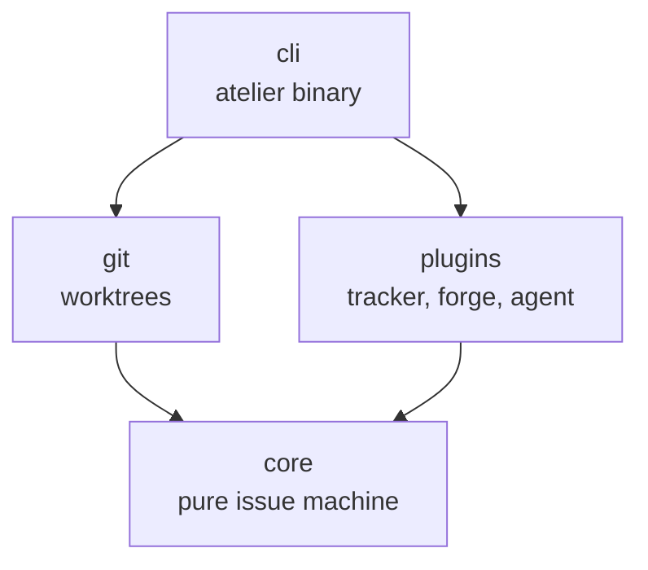

# Crates

The CLI assembles the plugins and owns I/O. The core defines the issue machine
and contracts, with no dependencies or I/O.



## Workspace

| Crate                 | Responsibility                                | Status                      |
| --------------------- | --------------------------------------------- | --------------------------- |
| `cli`                 | The `atelier` binary                          | Version and help in slice 0 |
| `core`                | Issue machine and plugin contracts            | Planned, slice 1            |
| `git`                 | Worktrees and branches behind core's contract | Planned, slice 1            |
| `../plugins/github`   | GitHub tracker and forge                      | Planned, slice 1            |
| `../plugins/opencode` | OpenCode sessions and permissions             | Planned, slice 1            |

The planned library crates contain crate documentation and no behavior.
Language plugins enter the workspace with their own slices.

```sh
cargo run --locked -p atelier-cli -- --version
# atelier 0.1.0-rc.2
```

## Rules

- Every member inherits the workspace version, edition, license and lints.
- The approved plan pins stable Rust; development uses `1.99.1` and CI also
  checks the declared `1.96` minimum.
- Core has no dependencies and performs no I/O. Concrete tools stay outside it.
- Functions contain at most 70 nonblank, noncomment lines.
- Failures are values; production paths contain no unwraps, expects or panics.
- Each thread, queue, resource and external call has a limit and an owner.
- A module with several concepts becomes a directory, one file per concept,
  with a README explaining the flow and usage.

## Checks

```sh
cargo fmt --all -- --check
cargo clippy --workspace --all-targets --all-features --locked -- -D warnings
cargo nextest run --workspace --all-targets --all-features --locked --no-tests=warn
cargo test --workspace --doc --all-features --locked
RUSTDOCFLAGS="-D warnings" cargo doc --workspace --no-deps --locked
cargo +1.96 check --workspace --all-targets --all-features --locked
cargo deny check
cargo mutants --workspace --timeout 120
```

The CLI's tests execute the real binary and check output streams and status.
Kani harnesses enter with the core state machine in slice 1.
