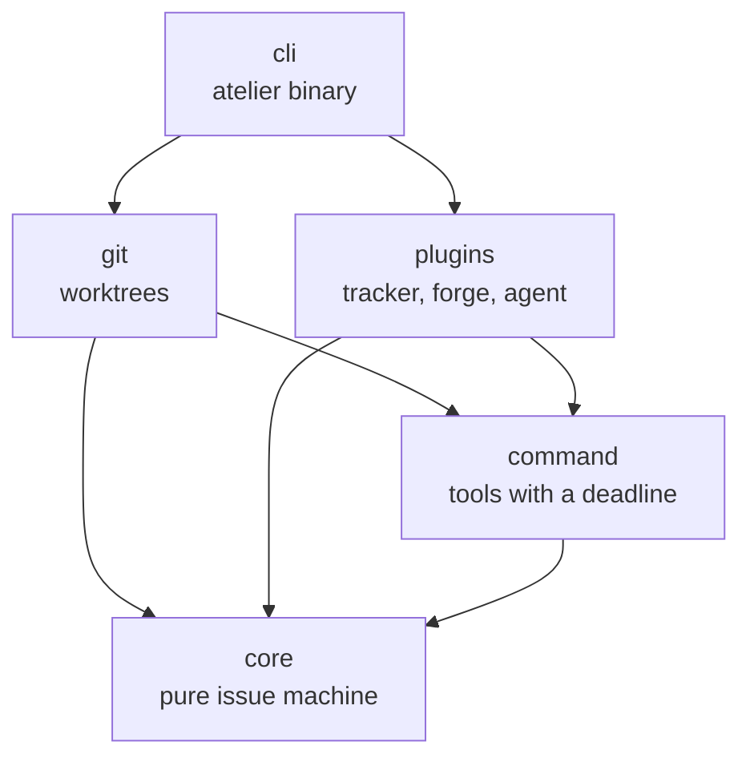

# Crates

The CLI assembles the plugins and owns I/O. The core defines the issue machine
and contracts, with no dependencies or I/O.



## Workspace

| Crate                 | Responsibility                                    | Status         |
| --------------------- | ------------------------------------------------- | -------------- |
| `cli`                 | The `atelier` binary: init, add, daemon, status   | Built, slice 1 |
| `core`                | Issue machine and plugin contracts                | Built, slice 1 |
| `command`             | Running a tool with a deadline and bounded output | Built, slice 1 |
| `git`                 | Worktrees and branches behind core's contract     | Built, slice 1 |
| `../plugins/commands` | Gates a project lists as commands                 | Built, slice 2 |
| `../plugins/github`   | GitHub tracker and forge                          | Built, slice 1 |
| `../plugins/opencode` | OpenCode sessions and permissions                 | Built, slice 1 |

Language plugins enter the workspace with their own slices.

```sh
cargo run --locked -p atelier-cli -- --version
# atelier 0.1.0-rc.8
```

## Rules

- Every member inherits the workspace version, edition, license and lints.
- Development and CI pin stable Rust `1.100.0`; every crate inherits the
  declared `1.100` minimum, which CI checks. The
  [Rust 1.100 page](../docs/plans/rust-1.100.md) lists what it leaves open.
- Core has no dependencies and performs no I/O. Concrete tools stay outside it.
- Functions contain at most 70 nonblank, noncomment lines.
- Failures are values; production paths contain no unwraps, expects or panics.
- Each thread, queue, resource and external call has a limit and an owner.
- A module with several concepts becomes a directory, one file per concept,
  with a README explaining the flow and usage.

## Checks

These are the gates CI runs, each inside its contained runner; on a
developer's Mac only `cargo fmt` runs, as [AGENTS.md](../AGENTS.md) says.

```sh
cargo fmt --all -- --check
cargo clippy --workspace --all-targets --all-features --locked -- -D warnings
cargo nextest run --workspace --all-targets --all-features --locked
cargo test --workspace --doc --all-features --locked
RUSTDOCFLAGS="-D warnings" cargo doc --workspace --no-deps --locked
cargo +1.100.0 check --workspace --all-targets --all-features --locked
cargo deny check
cargo mutants --workspace --timeout 120
cargo kani -p atelier-core
```

Kani proves the issue machine's promises for every phase and event; each
harness takes about 20 seconds.
