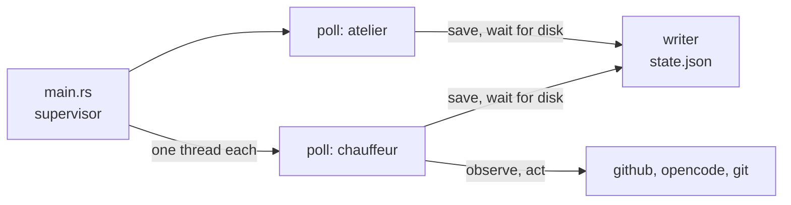

# The `atelier` command

The binary: it assembles the plugins, reads your projects and each project's
config, keeps the state, and runs the daemon the Homebrew service keeps
alive.

```sh
# in a project's checkout: its labels on GitHub
atelier init

# watch it: ~/.config/atelier/projects.toml
atelier add StevenJPx2/chauffeur

# poll every watched project; what the service runs
brew services start atelier

# each project's settings, where each came from, and each issue
atelier status
```



| File               | Holds                                                                |
| ------------------ | -------------------------------------------------------------------- |
| `main.rs`          | The commands                                                         |
| `commands.rs`      | `init`, `add` and `status`                                           |
| `paths.rs`         | Where your projects, the state and the worktrees live (XDG, or `~/`) |
| `projects.rs`      | `projects.toml`: your projects and your own filters                  |
| `config.rs`        | `.atelier/config.toml` from `origin`, what is found, what is set     |
| `plugins.rs`       | The plugins in the build, and each project's choice of them          |
| `state.rs`         | `state.json`, written whole and renamed into place                   |
| `log.rs`           | One line per event, with a UTC time                                  |
| `daemon/mod.rs`    | The supervisor: rereads `projects.toml` every 30 s                   |
| `daemon/lock.rs`   | The lock that lets one daemon run, holding its process id            |
| `daemon/poll.rs`   | One project's polls: interval, soon after acting, back-off           |
| `daemon/writer.rs` | The one thread that writes `state.json`                              |

- **One owner per issue.** Each project polls on its own thread and owns its
  issues, so two polls never claim the same issue and a slow project never
  holds up another.
- **On disk before acting.** Every save waits for the writer to write
  `state.json` (at most 30 s), so a phase is saved before its actions run.
- **Config from `origin`.** `.atelier/config.toml` is read from `origin`'s
  default branch; a `base` there names the base, and the rest is read from
  `origin/<base>`. A branch or a pull request cannot change its limits.
- **Timing.** A project polls every `poll` seconds (30 by default, at least
  15), again 5 s after it acted, and backs off on failure: as long as a rate
  limit asks, otherwise 30 s doubling to 10 minutes.
- **Stopping.** The daemon runs until it is stopped; since every action is
  saved first, it can be stopped at any moment.
