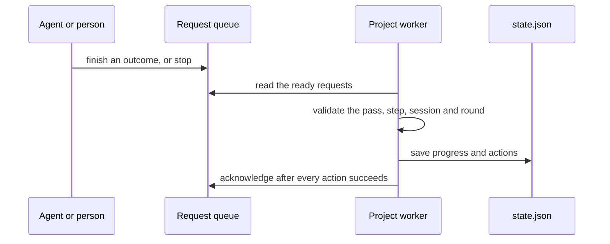

# Run requests

`atelier finish` and `atelier stop` leave immutable requests for a project's
worker. The worker reads them on its next poll, saves their effects, then
acknowledges them; it stays the only writer of `state.json`.



| File        | Holds                                                     |
| ----------- | --------------------------------------------------------- |
| `mod.rs`    | The project's queue folder                                |
| `file.rs`   | One request as its file keeps it                          |
| `queue.rs`  | Atomic submit, bounded read and acknowledgement           |
| `target.rs` | Find the working run by its worktree or pipeline/item key |

```sh
atelier finish clean "no advisories" --step audit
atelier stop "security-audit github#40" --repo StevenJPx2/atelier
```

- **Bounded.** A queue has 128 slots. A temporary file reserves a slot
  until it is written and renamed; a reader sees only ready files. A full
  queue refuses another request without waiting. Each file is at most
  8 KiB and a finish reason at most 4096 bytes.
- **One pass.** Each request names the run's generation, so one left from
  an older pass cannot affect a fresh run. A finish also names the step's
  session and failed-round count, and applies only while that resident step
  runs. A replay after a crash is harmless.
- **Stop first.** A stop preempts queued finishes and pending starts. It
  removes the trigger mark as well as the working mark, so it cannot start
  the run again from the same request.
- **Choosing a step.** Finish infers a unique running agent step declaring
  the outcome; ambiguity names the candidates and requires `--step`.
- **Queue folder.** `~/.local/state/atelier/requests/<owner>/<repo>/`.
