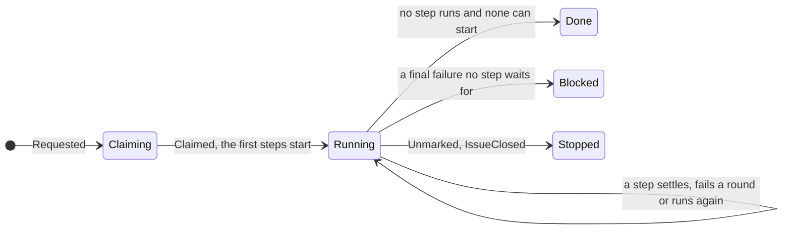

# The run machine

One pure function moves a run of a pipeline: `step(run, event, &plan)`
returns the next run and the actions that carry the move out. A run is its
phase and each step's progress; rungs decides which steps start, which are
skipped, and when the run is over. It does no I/O, so Kani proves its
promises for every pipeline of up to four steps.



| File        | Holds                                               |
| ----------- | --------------------------------------------------- |
| `phase.rs`  | `Run`, its `Phase`, `Reason` and `Event`            |
| `action.rs` | `Action` and the `Mark`s a tracker shows a person   |
| `step.rs`   | `step`, the whole machine as one `match` over rungs |
| `proofs.rs` | The Kani harnesses, under `cfg(kani)`               |

```rust
let plan = pipeline.plan();

let (next, actions) = step(run, Event::Settled { step: 0, outcome: Outcome(0) }, plan);
// → Running, [Start(1), Start(2)]: deps and audit, side by side
```

- A failed round under a step's `rounds` starts it again; its last one is
  final, and blocks the run unless a step waits for it.
- A push restarts a settled step and every step after it that depends on
  it; failed rounds are kept.
- Done, Blocked and Stopped each interrupt the resident steps, remove the
  working mark and remove the worktree.

```sh
cargo kani -p atelier-core
```
