# The issue machine

One pure function moves an issue from phase to phase:
`step(phase, event, &limits)` returns the next phase and the actions that
carry the move out. It does no I/O, so every pair of phase and event can be
checked, and Kani proves its promises for every one.

```mermaid
stateDiagram-v2
    direction LR
    [*] --> Claiming: Requested
    Claiming --> Preparing: Claimed
    Preparing --> Starting: WorktreeReady
    Starting --> Building: AgentStarted
    Building --> Open: PullRequestOpened
    Open --> Stage: AllPassed
    Stage --> Green: StagePassed, the last
    Green --> Ready: MarkedReady
    Ready --> Done: Merged
```



| File        | Holds                                               |
| ----------- | --------------------------------------------------- |
| `phase.rs`  | `Phase`, `Reason` and `Event`                       |
| `action.rs` | `Action` and the `Mark`s a tracker shows a person   |
| `limits.rs` | `Limits`: `red_rounds` and each stage's round limit |
| `step.rs`   | `step`, the whole machine as one `match`            |
| `proofs.rs` | The Kani harness, under `cfg(kani)`                 |

```rust
let limits = Limits::new(5, [("critic", 2)])?;

let (next, actions) = step(Phase::Open { rounds: 4 }, Event::RoundFailed, &limits);
// → Blocked(RedRounds), [Interrupt, Unmark(Working), Mark(Blocked), Comment(RedRounds)]
```

```sh
cargo kani -p atelier-core
```
