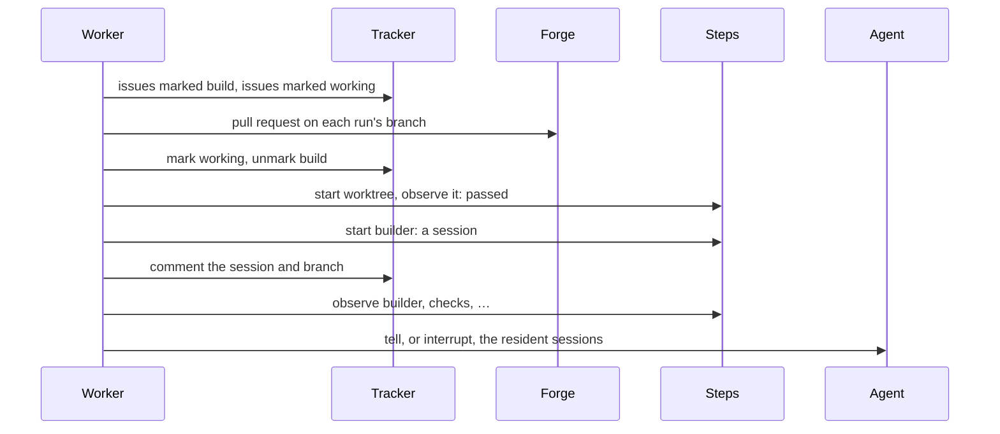

# One poll

A poll asks the plugins what they see of a project, then moves each item's
run: it observes the run's steps through their plugins, turns what they say
into events, and carries out the machine's actions. `observe` only reads;
`act` changes the world, and saves the state after every move and every
action.



| File         | Holds                                                                |
| ------------ | -------------------------------------------------------------------- |
| `project.rs` | `Project` with its pipelines, and `Plugins` with each kind of step   |
| `state.rs`   | `State`, each item's run as a `Record`, and each step's `StepRecord` |
| `observe.rs` | `observe`: listings with their tags, tracked issues, pull requests   |
| `act.rs`     | `act`: each run's events, pending actions, the brief, the `Report`   |

```rust
let observation = observe(&project, &plugins, &state)?;

let report = act(&observation, &mut state, &project, &plugins, &mut |state| store(state))?;
// report.moves → [Move { key: github#12, pipeline: "build", from: Running,
//                        to: Running, what: "worktree settled passed" }, …]
```

- **Events.** A claim confirms itself. A running run hears its steps first,
  in order: a running step that settled or failed a round, or a settled
  restart step that runs again. Then it hears its item: closed, or without
  the working mark. A run whose steps differ from its pipeline's blocks.
- **Resuming.** A move's actions wait in the run's `pending` list, and each
  leaves it once done; a start that made a session leaves its announcement
  in its place. A stop between two actions resumes at the next one; a stop
  right after an action, before its save, repeats it.
- **Failures.** A permanent failure while claiming or starting a step
  blocks the run; any other failure leaves the action pending and is
  reported. The listings' tags are kept only when every item succeeded, so
  a failed item is listed again.
- **Bounds.** One run makes at most 64 moves in a poll.
