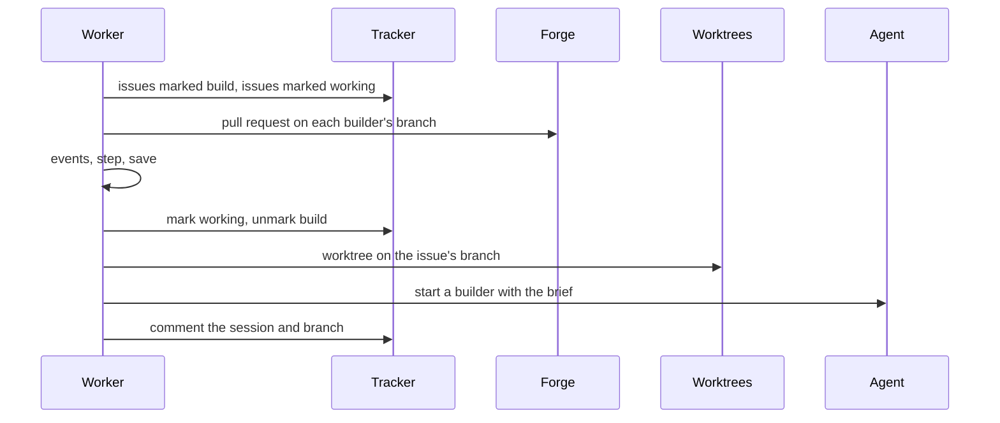

# One poll

A poll asks the plugins what they see of a project, turns that into events,
steps each issue and carries out its actions. `observe` only reads; `act`
changes the world, and saves the state after every step and every action.



| File         | Holds                                                              |
| ------------ | ------------------------------------------------------------------ |
| `project.rs` | `Project`, and `Plugins` with each tracker's `Source` and filter   |
| `state.rs`   | `State` and each issue's `Record`, with its branch name            |
| `observe.rs` | `observe`: listings with their tags, tracked issues, pull requests |
| `act.rs`     | `act`: steps, pending actions, the brief, the `Report`             |

```rust
let observation = observe(&project, &plugins, &state)?;

let report = act(&observation, &mut state, &project, &plugins, &mut |state| store(state))?;
// report.moves → [Move { key: github#12, from: Untracked, to: Claiming }, …]
```

- **Resuming.** A step's actions wait in the issue's `pending` list, and each
  leaves it once done. A stop between two actions resumes at the next one; a
  stop right after an action, before its save, repeats it.
- **Failures.** A permanent failure while starting blocks the issue; any
  other failure leaves the action pending and is reported. The listings' tags
  are kept only when every issue succeeded, so a failed issue is listed again.
- **Bounds.** One issue takes at most 32 steps in a poll.
