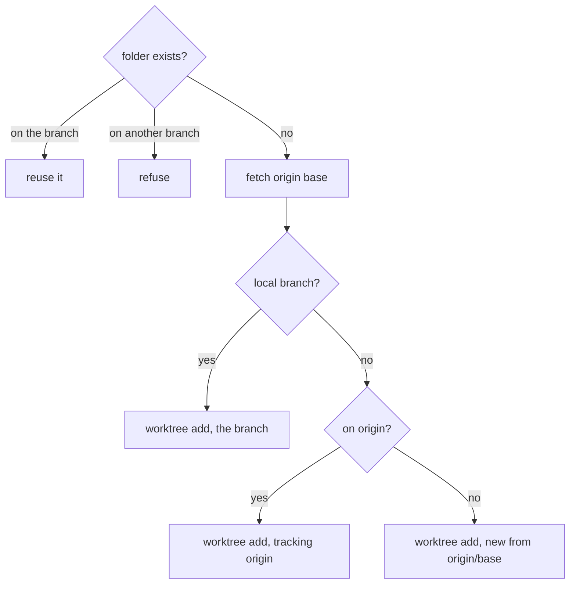

# Worktrees

Each issue's builder works in its own worktree, on its own branch, made
from atelier's own clone of the project through the `git` command and the
user's own sign-ins. The crate also reads a checkout's files for the gates,
and `origin`'s files at a branch for the config. As a plugin, `git` offers
pipelines the `git.worktree` kind of step.



| File            | Holds                                                                                                      |
| --------------- | ---------------------------------------------------------------------------------------------------------- |
| `worktree.rs`   | `Git`, core's `Worktrees`, and where each worktree lives                                                   |
| `repository.rs` | `Repository`: a project's bare clone or checkout, and `origin`; `BranchTree`, a branch of `origin`'s files |
| `steps.rs`      | `git` as a plugin, offering the `git.worktree` kind of step                                                |
| `tree.rs`       | `WorkingTree`: a checkout's files, core's `Tree`, its changes                                              |
| `folder.rs`     | Folder names from a repository's, kept inside their root                                                   |
| `command.rs`    | Running `git` through `atelier-command`, never prompting                                                   |

```rust
let git = Git::new("/Users/me/.local/share/atelier/worktrees");
let clone = Path::new("/Users/me/.local/share/atelier/clones/StevenJPx2/chauffeur.git");

let tree = git.create(&WorktreeRequest {
    repo: &Repo("StevenJPx2/chauffeur".into()),
    local: clone,
    name: "issue-12",
    branch: "issue-12-fix-the-dead-link",
    base: "v2",
})?;
// → /Users/me/.local/share/atelier/worktrees/StevenJPx2/chauffeur/issue-12
```

- A local branch is never reset, so a builder started again continues its
  work.
- Removing forces out what the builder left and keeps the branch; a worktree
  already gone is pruned from git's list.
- With `with_hooks`, each worktree gets atelier's hooks folder in its own
  config; the clone and other worktrees keep theirs.
- Every command runs in its own process group with a 120-second deadline,
  never prompts for credentials, and keeps the last 1 MiB of each output. On
  the deadline the whole group is killed, so a child such as `ssh` cannot
  hold it open.
- A failure to reach `origin` is transient; any other failure is permanent.
- Each folder name is letters, digits, `-`, `_` or `.`, so a repository's
  name cannot lead out of the root.
