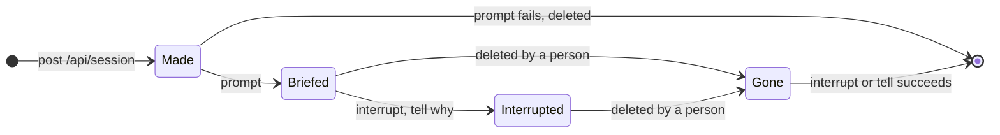
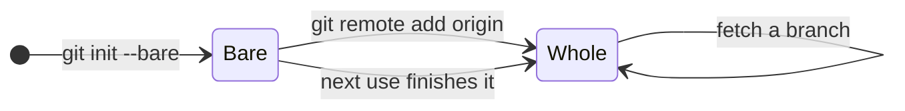
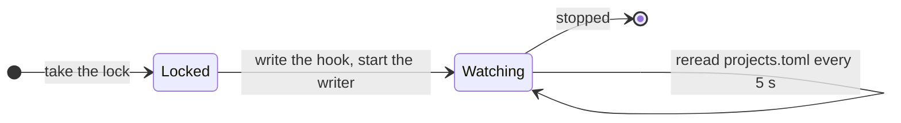

# Audit: atelier before slice 3

**Status: Fixed in `0.1.0-rc.8`.** Four findings, each reproduced twice and
fixed with its regression test; five more seen and not fixed, with why.

The audit covers the daemon and what it drives: the issue machine's actions
as `act` carries them out, builders' OpenCode sessions, atelier's clones and
worktrees, the supervisor, poll and writer threads, and the gates. It starts
from `main` at `14c9d84`, the source of `0.1.0-rc.7` with docs changes.

| Check                                                            | Result                                       |
| ---------------------------------------------------------------- | -------------------------------------------- |
| A clone with no `origin`, installed rc.7, scratch home, twice    | `atelier add` fails both times; control adds |
| Real OpenCode, interrupt and prompt of a deleted session         | `HTTP 404`, `SessionNotFoundError`           |
| Real OpenCode, `get /api/session?directory=<worktree>`           | lists that worktree's session alone          |
| Real binary, daemon killed while a builder is briefed, restarted | two sessions for one issue                   |
| Real binary, an issue closed whose builder session is gone       | never settles in Stopped                     |
| Real binary, a clone with no `origin`                            | the issue is never claimed                   |
| `SUPERVISE` against the docs                                     | 5 s in code, 30 s in two docs                |
| The same reproductions on the fixed build                        | one session; Stopped; clone finished         |
| Mutation testing over the fixes                                  | 28 mutants, 1 missed, then 0 with a test     |

## Findings

| Severity | Machine         | What could happen                                         | Issue | Fix                                                       |
| -------- | --------------- | --------------------------------------------------------- | ----- | --------------------------------------------------------- |
| High     | Builder session | Two builders on one issue after a stop during a start     | #44   | `fix(opencode): continue a builder a stopped start left`  |
| High     | Builder session | An issue never finishes stopping; `atelier:working` stays | #45   | `fix(opencode): let a stop finish when … session is gone` |
| High     | Clone           | A project fails every poll; `atelier add` fails for good  | #46   | `fix(cli): finish a clone left without its origin`        |
| Low      | Supervisor      | The docs give the wrong reread interval                   | #47   | `docs: say the daemon rereads projects.toml every 5 s`    |

### Two builders after a stop during a start (#44)

The daemon saves an issue's state before and after each action, not inside
one, and starting a builder is two OpenCode calls: make the session, then
brief it. A daemon stopped between them, as an upgrade's restart can, found
`StartBuilder` still pending and made a second session.

Evidence: `recovery::a_daemon_stopped_while_starting_a_builder_starts_no_second_one`
kills the daemon (SIGKILL) while the stand-in OpenCode takes ten seconds over
the brief, and restarts it: `left: 2, right: 1`. The control,
`a_labelled_issue_gets_one_builder_across_polls_and_a_restart`, makes one.

Fix: `start` lists the worktree's sessions first and continues the one with
the brief's title, briefing it only when it has no messages. `Agent::start`
takes the issue's last builder, which is never continued, so an issue
requested again gets a new session, as its stopped builder was told. Tests:
the recovery test, and the plugin's tests over captured replies: a briefed
session continued, an unbriefed one briefed, the replaced builder and another
issue's session not continued, a list that is not one refused.

### A stop that never finishes when the session is gone (#45)

Stopping or blocking an issue interrupts its builder and tells it why. A
deleted session answers 404, which atelier read as a permanent failure: the
action failed on every poll, and those after it, such as removing
`atelier:working`, never ran. Telling a deleted session that every check
passed wedged a green issue the same way.

Evidence: real OpenCode answers a deleted session's interrupt and prompt with
`HTTP 404 Not Found`; `recovery::an_issue_whose_builder_session_was_deleted_still_stops`
waited 30 seconds for Stopped.

Fix: interrupting or telling a session that is gone succeeds, since no
builder is left to stop or tell; the plugin reads a 404 as that. Tests: the
recovery test, and the plugin's interrupt and tell tests on a gone session.

### A clone left without its origin (#46)

A clone is made in two steps, `git init --bare` then `git remote add`, and
was made only when its folder held no repository. One left between the two
failed every poll, and `atelier status` showed
`git config --get remote.origin.url:` with nothing after it.

Evidence: the installed rc.7, in a scratch home with a bare repository and no
`origin` at the clone's path, fails `atelier add` twice; with no folder, it
adds. `recovery::a_clone_left_without_its_origin_is_repaired` waited 30
seconds for a builder. On the fixed build, `add` finishes the clone.

Fix: each use finishes a clone with no `origin`, through `create`. A git
failure that prints nothing says `failed, saying nothing`. Tests: the recovery
test; `a_whole_clone_is_used_as_it_is`, for the mutant that would make a
whole clone again on every poll; the command test for a silent failure.

### The supervisor's interval (#47)

`SUPERVISE` is 5 seconds; the slice 1 page and the CLI README said 30. Fix:
both say 5.

## Seen, not fixed

| Seen                                                                                                         | Reach                                                 | Why it stays                                                                       |
| ------------------------------------------------------------------------------------------------------------ | ----------------------------------------------------- | ---------------------------------------------------------------------------------- |
| The daemon rewrites the pre-commit hook in place at each start; a commit at that moment could run half of it | Read in the code; not reproduced                      | A start and a builder's commit in the same instant; the next commit is whole       |
| A first fetch of a very large repository runs past git's 120-second deadline, and starts over each poll      | Read in the code; atelier's projects fetch in seconds | The fix is a choice, a partial clone or a longer deadline, for when one is watched |
| `atelier add` and a poll making one clone at once: the second `git remote add` fails                         | Read in the code                                      | Only on the first poll after an add; the next `add` or poll succeeds               |
| A second daemon can read the lock's process id between the first's truncate and write                        | Read in the code                                      | Its message then names no process; it still refuses to start                       |
| Two `atelier add`s at once can both pass the "already watched" check                                         | Read in the code                                      | A person runs `add`; `projects.toml` keeps both, read as one                       |

## The machines

### Builder session

A builder's OpenCode session, as atelier sees it.

- One issue has one live builder: a start continues the worktree's session
  with its title, unless it is the issue's last builder.
- Every stop finishes, whether or not the session still exists.

| From                    | On                   | To          | Then                                           |
| ----------------------- | -------------------- | ----------- | ---------------------------------------------- |
| none                    | start                | Made        | brief it                                       |
| Made, daemon stopped    | start again          | Made        | **#44**: continued and briefed, not made again |
| Briefed, daemon stopped | start again          | Briefed     | **#44**: continued, not made again             |
| Briefed                 | stop or block        | Interrupted | tell it why                                    |
| Gone                    | stop, block or green | Gone        | **#45**: the action succeeds                   |

### Clone

atelier's bare clone of a watched project.

- A poll or `add` uses only a whole clone, with its `origin`.

| From  | On              | To    | Then                                        |
| ----- | --------------- | ----- | ------------------------------------------- |
| none  | `add` or a poll | Whole | init, add `origin`                          |
| Bare  | `add` or a poll | Whole | **#46**: finished, where it failed for good |
| Whole | `add` or a poll | Whole | used as it is                               |

### Daemon

The supervisor, one poll thread per project, and the one writer of
`state.json`.

- One daemon runs at a time; a second names the first and exits.
- A project's issues belong to its thread alone; each save is on disk
  before its action runs.

| From     | On                         | To       | Then                                                             |
| -------- | -------------------------- | -------- | ---------------------------------------------------------------- |
| none     | start, lock free           | Watching | a thread per project                                             |
| none     | start, lock held           | none     | exit, naming the holder                                          |
| Watching | a project added or removed | Watching | start or stop its thread, within 5 s (**#47**: the docs said 30) |
| Watching | stopped, any moment        | none     | the next start finishes what is pending                          |

The issue machine itself, `step`, is proved by Kani over every phase and
event, as [slice 1](../plans/slices/slice-1.md) shows; this audit changes no
transition of it.
