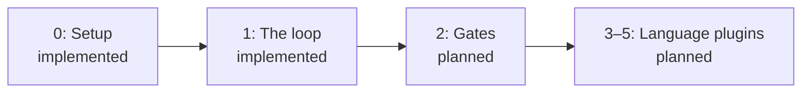

# Slices

atelier ships one usable behavior at a time. The owner reviews each released
slice before the next one starts.

| Slice                                   | Status                    | Plan                                                                  |
| --------------------------------------- | ------------------------- | --------------------------------------------------------------------- |
| 0: Install and run atelier              | Implemented, `0.1.0-rc.2` | [Setup](slices/slice-0.md)                                            |
| 1: A label becomes a ready pull request | Implemented, `0.1.0-rc.6` | [The loop](slices/slice-1.md)                                         |
| 2: Run project gates in forge CI        | Planned                   | [Gates](https://github.com/StevenJPx2/atelier/issues/1#slice-2-gates) |

The [architecture and ordered slice list](https://github.com/StevenJPx2/atelier/issues/1)
are the approved contract. [GitHub](https://github.com/StevenJPx2/atelier/issues/6)
and [OpenCode](https://github.com/StevenJPx2/atelier/issues/7) have separate
plugin plans. Each slice page describes what is built, its Structure and its
checks.
