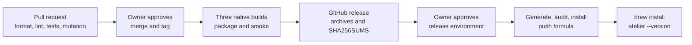

# Slice 0: install and run atelier

**Status: In progress.** Code and local gates pass. The owner approves the
merge and candidate tag; release CI and the Homebrew install complete this slice.

You can install atelier and check its version. The issue loop and daemon are
planned for slice 1; the service definition is available but is not started.

```sh
brew install StevenJPx2/taps/atelier

atelier --version
# atelier 0.1.0-rc.1
```



## What it builds

### Workspace and command

Five crates share one version and strict lints. The library crates carry only
crate documentation; slice 1 adds their behavior. Core and Git have no
external dependencies. The CLI uses the approved `clap` dependency.

Files: `Cargo.toml`, `Cargo.lock`, `rust-toolchain.toml`, `clippy.toml`,
`deny.toml`, `.cargo/mutants.toml`, `crates/*` and `plugins/*`.

```sh
cargo run --locked -p atelier-cli -- --version
# atelier 0.1.0
```

#### Structure

The command model is empty: Clap supplies help and version. The entry point
prints parsing errors and returns status 2, without calling `process::exit`.

```rust
struct Cli {}

fn main() -> std::io::Result<ExitCode>;
```

Verification: real-process tests assert version, help, invalid flags and missing
commands, including stdout, stderr and exit status. The MSRV check runs on
Rust 1.96; the approved plan's pinned stable toolchain is Rust 1.99.1.

### Check workflow

Every pull request runs Rust formatting, Clippy with warnings denied, nextest,
doc tests, rustdoc, cargo-deny, an MSRV check, Python format and lint, script
contract tests and two native release builds with packaged smoke tests. Mutation
testing covers the pull request's Rust diff.

Files: `.github/workflows/check.yml`, `crates/cli/tests/command.rs` and
`pyproject.toml`.

```sh
cargo nextest run --workspace --locked
# 3 passed

cargo mutants --workspace --timeout 120
# 1 mutant tested: 1 caught
```

#### Structure

Three jobs own distinct gates: `rust`, `msrv` and `package`. Package runs
on macOS arm64 and Linux x64. Actions are pinned by commit SHA; checkout does
not retain credentials. A newer run cancels a superseded check run.

Verification: the local commands in [Crates](../../../crates/README.md#checks)
and [Release tooling](../../../scripts/README.md#verify) pass. Pull request CI
must pass before merge. Kani proofs belong to slice 1's state machine.

### Candidate and Homebrew service

A version tag builds macOS arm64, Linux arm64 and Linux x64. Each runner checks
the tag against the workspace version, packages its native binary and runs it.
The publish job creates a GitHub release with all three archives and SHA256SUMS.

The tap job waits in the protected `release` environment for the owner's
review. Its dedicated deploy key writes only to `StevenJPx2/homebrew-taps`.
It generates the formula from the published checksums, audits it, installs and
tests it, then pushes the formula. Missing credentials fail the job.

Files: `.github/workflows/release.yml` and [`scripts/`](../../../scripts/README.md).

```sh
python3 scripts/release.py package \
  --target darwin-arm64 --binary target/release/atelier

python3 scripts/release.py smoke dist/atelier-*.tar.gz
# ...: packaged version and help passed
```

#### Structure

The script exposes five commands: `version`, `package`, `sums`, `formula`
and `smoke`. Archive layout, file-size limits and validation live in
[Release tooling](../../../scripts/README.md). The service template runs
`atelier daemon` with `keep_alive true`, Homebrew's standard PATH and one
log under Homebrew's `var/log/`.

Verification: nine script contract tests, the native tarball smoke test, then
`brew style`, `brew audit --strict --online`, install and `brew test` in
the protected job. The workflow is complete only after all three builds and the
tap job pass and the owner's local install reports the candidate version.

## End to end

1. Run the full local gates and package the release binary.
2. Open a pull request and wait for every Check job to pass.
3. Obtain the owner's approval to merge and cut `0.1.0-rc.1`.
4. Bump the workspace version, regenerate the lockfile, commit with
   `chore(release): 0.1.0-rc.1`, and wait for Check to pass.
5. Obtain the owner's approval for `v0.1.0-rc.1` and push the tag.
6. Watch all native builds and the GitHub release finish; the owner approves
   the protected tap job.
7. Install with `brew install StevenJPx2/taps/atelier`, run `brew test`, and
   confirm `atelier --version` prints `atelier 0.1.0-rc.1`.

Slice 1 waits for the owner's review of this candidate. No service or builder
starts as part of slice 0's proof.
