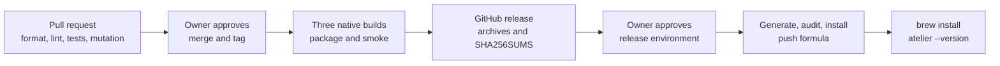
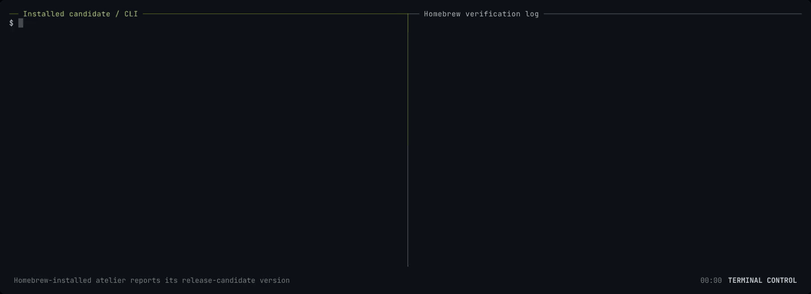

# Slice 0: install and run atelier

**Status: Implemented, `0.1.0-rc.2`.** The candidate installs through Homebrew
and passes its real formula test.

You can install atelier and check its version. The issue loop and daemon are
planned for slice 1; the service definition is available but is not started.

```sh
brew install StevenJPx2/taps/atelier

atelier --version
# atelier 0.1.0-rc.2
```



## Recording

The Homebrew-installed candidate prints its version and help in the left pane.
The right pane shows the real Homebrew test executing that installed binary;
the shell reports exit status 0. Slice 0 has no daemon or model session.

The terminal-control capture runs in a scratch repository with isolated XDG
configuration and state. The GIF is 1600 pixels wide, 10.4 seconds and 162 KB;
it links to the H.264 original. Frames from its beginning and final result are
inspected for private data.

[](../../media/slice-0.mp4)

## What it builds

### Workspace and command

Five crates share one version and strict lints. The library crates carry only
crate documentation; slice 1 adds their behavior. Core and Git have no
external dependencies. The CLI uses the approved `clap` dependency.

Files: `Cargo.toml`, `Cargo.lock`, `rust-toolchain.toml`, `clippy.toml`,
`deny.toml`, `.cargo/mutants.toml`, `crates/*` and `plugins/*`.

```sh
cargo run --locked -p atelier-cli -- --version
# atelier 0.1.0-rc.2
```

#### Structure

The command model is empty: Clap supplies help and version. The entry point
prints parsing errors and returns status 2, without calling `process::exit`.

```rust
struct Cli {}

fn main() -> std::io::Result<ExitCode>;
```

Verification: the packaged smoke run executes the built binary's `--version`
and `--help` on each target; slice 0 has no Rust tests. Mutation testing
excludes `main` by name until slice 1 gives it behavior to test. The MSRV check runs on
Rust 1.96; the approved plan's pinned stable toolchain is Rust 1.99.1.

### Check workflow

Every pull request runs Rust formatting, Clippy with warnings denied, nextest,
doc tests, rustdoc, cargo-deny, an MSRV check, Python format and lint, and two
native release builds with packaged smoke tests. Mutation testing covers the
pull request's Rust diff.

Files: `pyproject.toml`; the checks run through `.atelier/config.toml` and
`.github/workflows/atelier.yml`, as [slice 2](slice-2.md) builds them, and
the packaged smoke tests in `.github/workflows/package.yml`.

```sh
cargo nextest run --workspace --locked --no-tests=warn
# 0 tests run

cargo mutants --workspace --timeout 120
# no mutants to test
```

#### Structure

Three jobs own distinct gates: `rust`, `msrv` and `package`. Package runs
on macOS arm64 and Linux x64. Actions are pinned by commit SHA; checkout does
not retain credentials. A newer run cancels a superseded check run.

Verification: the local commands in [Crates](../../../crates/README.md#checks)
and [Release tooling](../../../scripts/README.md#verify) pass. Pull request CI
must pass before merge. Kani proofs belong to slice 1's state machine.

### Candidate and Homebrew service

A version tag builds macOS arm64, Linux arm64 and Linux x64. Each runner checks
the tag against the workspace version, packages its native binary and runs it.
The publish job creates a GitHub release with all three archives and SHA256SUMS.

The tap job waits in the protected `release` environment for the owner's
review. Its dedicated deploy key writes only to `StevenJPx2/homebrew-taps`.
It generates the formula from the published checksums, audits it, installs and
tests it, then pushes the formula. Missing credentials fail the job.

Files: `.github/workflows/release.yml` and [`scripts/`](../../../scripts/README.md).

```sh
python3 scripts/release.py package \
  --target darwin-arm64 --binary target/release/atelier

python3 scripts/release.py smoke dist/atelier-*.tar.gz
# ...: packaged version and help passed
```

#### Structure

The script exposes five commands: `version`, `package`, `sums`, `formula`
and `smoke`. Archive layout, file-size limits and validation live in
[Release tooling](../../../scripts/README.md). The service template runs
`atelier daemon` with `keep_alive true`, Homebrew's standard PATH and one
log under Homebrew's `var/log/`.

Verification: the native tarball smoke test on each target, then
`brew style`, `brew audit --strict --online`, install and `brew test` in
the protected job. The workflow is complete only after all three builds and the
tap job pass and the owner's local install reports the candidate version.

## End to end

- [Pull request #8](https://github.com/StevenJPx2/atelier/pull/8) and
  [the formula fix](https://github.com/StevenJPx2/atelier/pull/9)
  pass the pull-request gates.
- [The release commit's Check run](https://github.com/StevenJPx2/atelier/actions/runs/43021461460)
  passes formatting, lint, tests, MSRV and packaged smoke checks.
- [The candidate release](https://github.com/StevenJPx2/atelier/releases/tag/v0.1.0-rc.2)
  contains three native archives and SHA256SUMS.
- [The complete Release run](https://github.com/StevenJPx2/atelier/actions/runs/43021654905)
  passes all three native builds and smoke tests, then the owner-approved tap
  job: style, strict online audit, install, test and formula publication.
- The local Apple Silicon install through `StevenJPx2/taps/atelier` reports
  `atelier 0.1.0-rc.2`; `brew test --verbose StevenJPx2/taps/atelier` exits 0.
  Linux binaries are smoke-tested on their native CI runners; a Linux Homebrew
  install is not part of the local proof.
- `brew services info atelier --json` reports `running: false` and
  `loaded: false`. Its command is `atelier daemon`, with logs in Homebrew's
  `var/log/atelier.log`.
- Eight Mermaid fences across the changed Markdown pages render in GitHub's
  actual preview. The recording's codec, width and size are checked by ffprobe.

Local Homebrew's RuboCop plugin emits an upstream obsolete-configuration warning
about `IgnoredPatterns`. No formula offense is reported, and no warning is
suppressed. The protected CI style and strict online audit gates pass.

Slice 1 waits for the owner's review of this candidate. No service or builder
starts as part of slice 0's proof.
