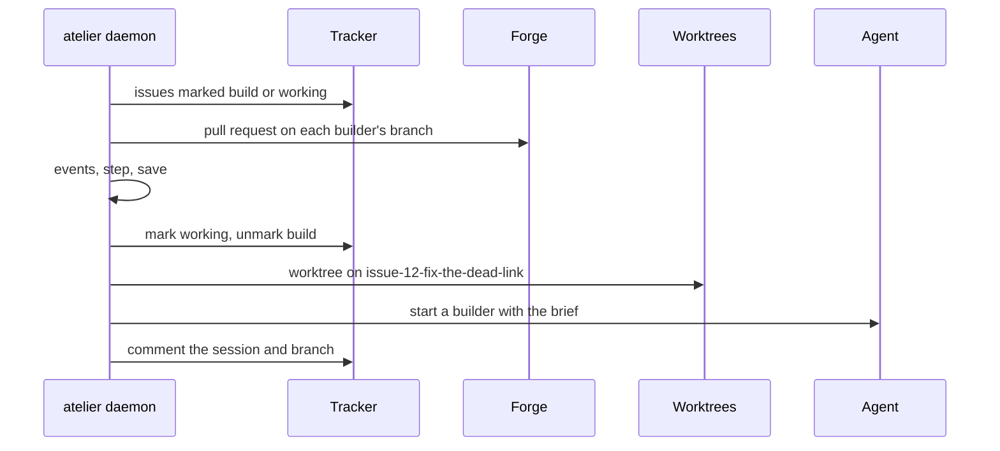

# Slice 1: a label becomes a ready pull request

**Status: In progress.** The core is built: the issue machine and its Kani
proofs, the poll's events, `observe` and `act`, the roles and the registry.
So are `crates/git` and the `github` plugin
([#6](https://github.com/StevenJPx2/atelier/issues/6)). Then the `opencode` plugin
([#7](https://github.com/StevenJPx2/atelier/issues/7)), and the CLI and daemon,
one pull request each.

You can label an issue `atelier:build` in a watched project and, within a
poll, find a builder working on it in its own worktree. It opens a draft pull
request, fixes what CI reports, and marks it ready when every check passes.

```sh
gh issue edit 12 --add-label atelier:build
# a poll later: atelier:working, and a comment naming the session and branch
```



## What it builds

### The core (`crates/core`)

The issue machine, the events a poll means, one poll's `observe` and `act`,
the roles plugins fill and the registry they fill them in. No I/O and no
dependencies.

Files: [`crates/core/src/`](../../../crates/core/src), with a README in each
of `machine/`, `poll/` and `roles/`, and the contract in
`crates/core/prompts/builder.md`.

```rust
let pipeline = Pipeline::new(5, [("critic", 2)])?;

let (next, actions) = step(Phase::Open { rounds: 4 }, Event::RoundFailed, &pipeline);
// → Blocked(RedRounds), [Interrupt, Unmark(Working), Mark(Blocked), Comment(RedRounds)]

let observation = observe(&project, &plugins, &state)?;

let report = act(&observation, &mut state, &project, &plugins, &mut save)?;
// report.steps → [Step { key: github#12, from: Untracked, to: Claiming }, …]
```

#### Structure

A phase is where one issue is; an event is what a poll saw or an action
confirmed. `rounds` counts failed CI rounds and `index` is a stage's
position. `is_working` holds from Claiming to Ready, `has_builder` from
Building and `has_pull_request` from Open.

```rust
pub enum Phase {
    Untracked,
    Claiming,
    Preparing,
    Starting,
    Building,
    Open { rounds: u8 },
    Stage { index: u8, rounds: u8 },
    Green { rounds: u8 },
    Ready { rounds: u8 },
    Done,
    Blocked(Reason),
    Stopped,
}

pub enum Reason { Start, RedRounds, Stage(u8), Closed, LostTrack }

pub enum Event {
    Requested,
    Claimed,
    WorktreeReady,
    AgentStarted,
    StartFailed,
    PullRequestOpened,
    Pushed,
    RoundFailed,
    AllPassed,
    StagePassed,
    StageFailed { rounds: u8 },
    MarkedReady,
    Merged,
    ClosedUnmerged,
    Unmarked,
    IssueClosed,
    LostTrack,
}

impl Phase {
    pub const fn is_working(self) -> bool;
    pub const fn has_builder(self) -> bool;
    pub const fn has_pull_request(self) -> bool;
    pub const fn rounds(self) -> u8;
}
```

A step names actions; marks show a person the phase, and each tracker maps
them to its labels. A pipeline refuses a limit of zero and more than eight
stages; `limit` is none past the last stage.

```rust
pub enum Mark { Build, Working, Blocked }

pub enum Action {
    Mark(Mark),
    Unmark(Mark),
    CreateWorktree,
    StartBuilder,
    CommentSession,
    StartStage(u8),
    Interrupt,
    CloseIssue,
    RemoveWorktree,
    Comment(Reason),
}

pub struct Pipeline {
    red_rounds: u8,
    limits: [u8; MAX_STAGES],
    count: u8,
    names: Vec<String>,
}

impl Pipeline {
    pub fn new<'a>(
        red_rounds: u8,
        stages: impl IntoIterator<Item = (&'a str, u8)>,
    ) -> Result<Self, PipelineError>;
    pub const fn red_rounds(&self) -> u8;
    pub const fn stages(&self) -> u8;
    pub fn stage_name(&self, index: u8) -> Option<&str>;
    pub fn limit(&self, index: u8) -> Option<u8>;
}

pub enum PipelineError { NoRedRounds, NoStageRounds { stage }, TooManyStages { count } }

pub fn step(phase: Phase, event: Event, pipeline: &Pipeline) -> (Phase, Vec<Action>);
```

`step` is one `match`. Every way out of a working phase removes the working
mark; every way out after Starting, except a merge, interrupts the builder.
Requesting a blocked issue again also removes its blocked mark. Blocking adds
three actions: unmark working, mark blocked, and a comment saying why.

A poll's view of one issue becomes events, most urgent first: a merge, then a
closed issue or a removed working mark, then progress. Claiming hears none,
since the worker finishes a claim from its own record. A failed round is a
head commit with a failed check; a pending head after the pull request opened
is a push.

```rust
pub struct Marks { build: bool, working: bool, blocked: bool }

impl Marks {
    pub const fn has(self, mark: Mark) -> bool;
    pub const fn with(self, mark: Mark) -> Self;
    pub const fn without(self, mark: Mark) -> Self;
}

pub enum Checks { Pending, Passed, Failed }

pub enum PullRequest {
    Open { number: u64, draft: bool, failed_rounds: u8, checks: Checks },
    Merged { number: u64 },
    Closed { number: u64 },
}

pub enum StageOutcome { Passed, Failed { rounds: u8 } }

pub struct Seen {
    pub open: bool,
    pub marks: Marks,
    pub pull_request: Option<PullRequest>,
    pub stage: Option<StageOutcome>,
}

pub fn events(phase: Phase, seen: &Seen) -> Vec<Event>;
```

The roles. A tracker lists issues carrying a mark that match a filter, or
answers `Unchanged` when the tag still holds; marking, unmarking and closing
are idempotent. A plugin's failure says whether a retry can help.

```rust
pub struct Repo(pub String);

pub struct IssueKey { pub tracker: String, pub id: String }

pub struct Issue { pub key: IssueKey, pub title: String, pub open: bool, pub marks: Marks }

pub struct Filter {
    pub assignee: Option<String>,
    pub author: Option<String>,
    pub labels: Vec<String>,
    pub query: Option<String>,
}

pub enum Listing { Unchanged, Changed { issues: Vec<Issue>, etag: Option<String> } }

pub struct Session { pub id: String, pub title: String }

pub enum Failure { Transient, RateLimited { retry_after_secs: u64 }, Permanent }

pub struct PluginError { pub failure: Failure, pub message: String }

pub trait Tracker {
    fn issues(
        &self,
        repo: &Repo,
        mark: Mark,
        filter: &Filter,
        etag: Option<&str>,
    ) -> Result<Listing, PluginError>;
    fn issue(&self, repo: &Repo, id: &str) -> Result<Issue, PluginError>;
    fn mark(&self, repo: &Repo, id: &str, mark: Mark) -> Result<(), PluginError>;
    fn unmark(&self, repo: &Repo, id: &str, mark: Mark) -> Result<(), PluginError>;
    fn comment(&self, repo: &Repo, id: &str, text: &str) -> Result<(), PluginError>;
    fn close(&self, repo: &Repo, id: &str) -> Result<(), PluginError>;
    fn reference(&self, issue: &Issue) -> String;
    fn brief(&self, repo: &Repo, issue: &Issue) -> String;
}

pub trait Forge {
    fn pull_request(&self, repo: &Repo, branch: &str) -> Result<Option<PullRequest>, PluginError>;
    fn brief(&self, repo: &Repo, base: &str, branch: &str) -> String;
    fn denied(&self) -> Vec<String>;
}

pub trait Agent {
    fn start(&self, worktree: &Path, brief: &Brief) -> Result<Session, PluginError>;
    fn interrupt(&self, session: &Session) -> Result<(), PluginError>;
}

pub struct WorktreeRequest<'a> {
    pub repo: &'a Repo,
    pub checkout: &'a Path,
    pub name: &'a str,
    pub branch: &'a str,
    pub base: &'a str,
}

pub trait Worktrees {
    fn create(&self, request: &WorktreeRequest<'_>) -> Result<PathBuf, PluginError>;
    fn remove(&self, checkout: &Path, worktree: &Path) -> Result<(), PluginError>;
}
```

A plugin registers the roles it fills under its name. A project with no agent
named takes the build's only one.

```rust
pub trait Plugin {
    fn name(&self) -> &'static str;
    fn register<'a>(&'a self, registry: &mut Registry<'a>);
}

pub enum Role { Tracker, Forge, Agent }

pub struct MissingPlugin { pub role: Role, pub name: Option<String>, pub available: Vec<&'static str> }

impl<'a> Registry<'a> {
    pub fn new(plugins: &[&'a dyn Plugin]) -> Self;
    pub fn tracker(&mut self, tracker: &'a dyn Tracker);
    pub fn forge(&mut self, forge: &'a dyn Forge);
    pub fn agent(&mut self, agent: &'a dyn Agent);
    pub fn find_tracker(&self, name: &str) -> Result<&'a dyn Tracker, MissingPlugin>;
    pub fn find_forge(&self, name: &str) -> Result<&'a dyn Forge, MissingPlugin>;
    pub fn find_agent(&self, name: Option<&str>) -> Result<&'a dyn Agent, MissingPlugin>;
}
```

The brief is the contract filled in for one issue, then each plugin's part,
and the denied commands: `git tag *` and `git push * --tags` from core, and
the forge's own.

```rust
pub struct Brief {
    pub title: String,
    pub branch: String,
    pub parts: Vec<String>,
    pub denied: Vec<String>,
}

impl Brief {
    pub fn new(
        reference: &str,
        issue: &Issue,
        branch: &str,
        base: &str,
        pipeline: &Pipeline,
    ) -> Self;
    pub fn with(self, part: String) -> Self;
    pub fn deny(self, patterns: impl IntoIterator<Item = String>) -> Self;
    pub fn text(&self) -> String;
}
```

One poll. `observe` lists each tracker's issues marked build, with its
filter, and marked working, so an issue atelier never took is found; reads
every issue atelier is working on; and asks the forge for each builder's pull
request. `act` steps each issue at most 32 times, saving after each step
and each action. A step's actions wait in the record's `pending` list, so a
stop resumes at the next one. A permanent failure while starting blocks the
issue; any other failure leaves the action pending and is reported. The
listing tags are kept only when every issue succeeded.

```rust
pub struct Project { pub repo: Repo, pub checkout: PathBuf, pub base: String, pub pipeline: Pipeline }

pub struct Source<'a> { pub name: &'a str, pub tracker: &'a dyn Tracker, pub filter: Filter }

pub struct Plugins<'a> {
    pub trackers: Vec<Source<'a>>,
    pub forge: &'a dyn Forge,
    pub agent: &'a dyn Agent,
    pub worktrees: &'a dyn Worktrees,
}

pub struct State {
    pub issues: BTreeMap<IssueKey, Record>,
    pub etags: BTreeMap<(String, Mark), String>,
}

pub struct Record {
    pub phase: Phase,
    pub title: String,
    pub branch: String,
    pub worktree: Option<PathBuf>,
    pub session: Option<Session>,
    pub pending: Vec<Action>,
}

impl Record {
    pub fn new(key: &IssueKey, title: &str) -> Self;
    pub fn folder(key: &IssueKey) -> String;
}

pub struct Observation {
    pub issues: BTreeMap<IssueKey, Observed>,
    pub etags: BTreeMap<(String, Mark), String>,
}

pub struct Observed { pub issue: Issue, pub seen: Seen }

pub struct Report { pub steps: Vec<Step>, pub failures: Vec<(IssueKey, PluginError)> }

pub struct Step { pub key: IssueKey, pub from: Phase, pub to: Phase }

pub fn observe(
    project: &Project,
    plugins: &Plugins<'_>,
    state: &State,
) -> Result<Observation, PluginError>;

pub fn act<E>(
    observation: &Observation,
    state: &mut State,
    project: &Project,
    plugins: &Plugins<'_>,
    save: &mut impl FnMut(&State) -> Result<(), E>,
) -> Result<Report, E>;
```

A record's branch is `issue-<id>-<slug>`, the title's words in lowercase up
to 40 characters, and its worktree folder `issue-<id>`.

#### Verification

- **Kani**, four harnesses, one for each pipeline of zero to three stages,
  each limit 1 or 2 and `red_rounds` 1 to 5, over every phase and event.
  About 20 seconds each.

  ```text
  for all stages   = 0 to 3 stages, each with a limit of 1 to 2
  for all pipeline = red_rounds 1 to 5, with those stages
  for all phase    = every phase, rounds 0 to red_rounds, index 0 to stages - 1
  for all event    = every event, with stage rounds 0 to 2

  (next, actions) = step(phase, event, pipeline)

  assert actions has StartBuilder
         == (phase == Preparing and event == WorktreeReady)
  assert next == Starting, entered, implies phase == Preparing and event == WorktreeReady
  assert next == Claiming, entered, implies event == Requested
  assert working(phase) and not working(next) implies actions has Unmark(Working)
  assert has_builder(phase) and not working(next) and next != Done
         implies actions has Interrupt
  assert next == Green, entered,
         implies (phase == Stage(stages - 1) and event == StagePassed)
              or (phase == Open and event == AllPassed and stages == 0)
  assert event == Merged and has_pull_request(phase) implies actions has CloseIssue
  assert next.rounds <= red_rounds and next is Stage(i) implies i < stages
  assert next == phase implies actions is empty
  ```

- **Unit tests**: every arm of `step` and its guards, `events` for each
  phase, and the pipeline's limits and refusals.
- **Poll tests** against an in-memory tracker, forge, agent and worktrees: one
  builder across many polls; a stop after every save resumes to the same end;
  a transient failure retries and keeps the listing unconfirmed; a permanent
  start failure blocks; a blocked issue requested again keeps its branch; the
  working mark removed or the issue closed stops the builder; failed rounds
  block at the limit; checks, ready and a merge close the issue and remove the
  worktree; a pull request closed unmerged blocks; an issue marked working that
  atelier never took is blocked; a finished issue is not read again.
- **Mutation testing** over `crates/core`.

```sh
cargo kani -p atelier-core
cargo nextest run -p atelier-core
cargo mutants -p atelier-core
```

### Worktrees (`crates/git`)

A worktree for each issue under
`~/.local/share/atelier/worktrees/<owner>/<repo>/issue-<n>`, on the issue's
branch: reused when it is there, made from the local branch, the branch on
`origin`, or a new branch from `origin/<base>`.

Files: [`crates/git/`](../../../crates/git/README.md).

```rust
let git = Git::new("/Users/me/.local/share/atelier/worktrees");

let tree = git.create(&WorktreeRequest {
    repo: &Repo("StevenJPx2/chauffeur".into()),
    checkout: Path::new("/Users/me/Documents/Projects/chauffeur"),
    name: "issue-12",
    branch: "issue-12-fix-the-dead-link",
    base: "v2",
})?;
// → /Users/me/.local/share/atelier/worktrees/StevenJPx2/chauffeur/issue-12
```

#### Structure

`Git` fills core's `Worktrees` role. A worktree already on another branch
is refused; a local branch is never reset; removing forces out what the
builder left and keeps the branch. A repository that is not `owner/name`,
or a part that could leave the root, is refused.

```rust
pub struct Git {
    root: PathBuf,
}

impl Git {
    pub fn new(root: impl Into<PathBuf>) -> Self;
}

impl Worktrees for Git {}
```

Each `git` call has a 120-second deadline and `GIT_TERMINAL_PROMPT=0`, through
[`atelier-command`](#running-tools-cratescommand). Reaching `origin` fails
transiently; anything else fails permanently.

```rust
fn git(dir: &Path, args: &[&str]) -> Result<Output, PluginError>;
fn checked(dir: &Path, args: &[&str]) -> Result<String, PluginError>;
```

#### Verification

Tests against real repositories: a bare `origin` with `v2`, and a clone as
the checkout. A new branch starts from the newest `origin/v2` and is reused;
a local branch keeps its commits; a branch only on `origin` is continued and
tracked; a folder on another branch is refused; removing drops the worktree
and its changes, keeps the branch, and succeeds twice; names that could leave
the root are refused. Only remote failures are transient.

```sh
cargo nextest run -p atelier-git
```

### Running tools (`crates/command`)

`git`, `gh` and `opencode` each run through one runner, so a hung tool never
holds up a poll.

Files: [`crates/command/src/lib.rs`](../../../crates/command/src/lib.rs).

```rust
let mut command = Command::new("git");
command.arg("--version");

let output = atelier_command::run(command, Duration::from_secs(10))?;
// → Output { success: true, stdout: "git version 2.56.0\n", stderr: "" }
```

#### Structure

A command runs with no input in its own process group. On its deadline the
whole group is killed, so a child it started cannot hold the output open, and
the failure is transient. At most 1 MiB of each output is kept.

```rust
pub struct Output {
    pub success: bool,
    pub stdout: String,
    pub stderr: String,
}

pub fn run(command: Command, deadline: Duration) -> Result<Output, PluginError>;
```

#### Verification

A command past its deadline is killed with its children within the deadline;
output stops at its bound; a missing tool fails transiently.

### The `github` plugin (`plugins/github`)

GitHub as tracker and forge, through `gh` ([#6](https://github.com/StevenJPx2/atelier/issues/6)).
Its CI part, `gates.yml`, comes with slice 2.

Files: [`plugins/github/`](../../../plugins/github/README.md).

```rust
let github = GitHub::new();
let repo = Repo("StevenJPx2/chauffeur".into());
let mine = Filter { assignee: Some("StevenJPx2".into()), ..Filter::default() };

let listing = github.issues(&repo, Mark::Build, &mine, Some(etag))?;
// → Listing::Unchanged, from a 304

github.mark(&repo, "12", Mark::Working)?;

let pull = github.pull_request(&repo, "issue-12-fix-the-dead-link")?;
// → Some(PullRequest::Open { number: 31, draft: true, failed_rounds: 1, checks: Passed })
```

#### Structure

`GitHub` runs `gh` from `PATH`, or another program, such as a stand-in in
tests. It registers as `github`, the name its issue keys carry, in both
roles. `create_labels` makes atelier's labels with `gh label create --force`.

```rust
pub struct GitHub {
    program: PathBuf,
}

impl GitHub {
    pub fn new() -> Self;
    pub fn with_program(program: impl Into<PathBuf>) -> Self;
    pub fn create_labels(&self, repo: &Repo) -> Result<(), PluginError>;
}

pub const LABELS: [(&str, &str, &str); 4];

impl Plugin for GitHub {}
impl Tracker for GitHub {}
impl Forge for GitHub {}
```

Every call is `gh api --include`, read whatever its status: a 304 is
unchanged; a 403 with `Retry-After` or no rate left, or a 429, waits that
long (60 seconds when GitHub does not say); a 5xx or no reply is transient;
any other error status is permanent. A listing reads at most ten pages and
keeps a tag only when it is one page. A filter's `query` uses search, with no
tag. Removing a label that is gone succeeds.

```rust
struct Reply {
    pub status: u16,
    pub headers: Vec<(String, String)>,
    pub body: String,
}

impl Reply {
    pub fn header(&self, name: &str) -> Option<&str>;
    pub fn next(&self) -> Option<&str>;
    pub fn ok(self, what: &str) -> Result<Self, PluginError>;
}
```

The forge asks one GraphQL query for the newest pull request on the branch,
with its last 100 commits' combined check state. A failed round is a commit
whose checks failed or errored; the head's checks are pending until they
report. The brief tells the builder to open the pull request as a draft,
watch it with a sourcefed `github` monitor and mark it ready with
`gh pr ready`; `gh pr merge` and `gh release` are denied.

#### Verification

A stand-in `gh` replays replies captured from GitHub, listed in
[`fixtures/README.md`](../../../plugins/github/tests/github/fixtures/README.md):
one page keeps its tag and the same listing then answers 304; pages are
followed, pull requests dropped and no tag kept; a filter becomes the query
string; a query goes through search; a missing issue is permanent; a rate
limit waits 60 seconds and an unreachable GitHub retries; marks, comments and
closing send what GitHub expects; PR #8's real history reads as merged, and
open with one failed round; the plugin registers under the name its issues
carry. One test runs the same reads against the real GitHub when `gh` is
signed in.

### The `opencode` plugin

Planned in its own issue: [#7](https://github.com/StevenJPx2/atelier/issues/7).

### The CLI and daemon (`crates/cli`)

Planned: `atelier init`, `add`, `daemon` and `status`, as
[the plan](https://github.com/StevenJPx2/atelier/issues/1#slice-1-the-loop)
describes.

## End to end

Planned, after the CLI: the Chauffeur run and a small atelier issue, each
labelled with the owner's approval, as
[the plan](https://github.com/StevenJPx2/atelier/issues/1#end-to-end) lists.
