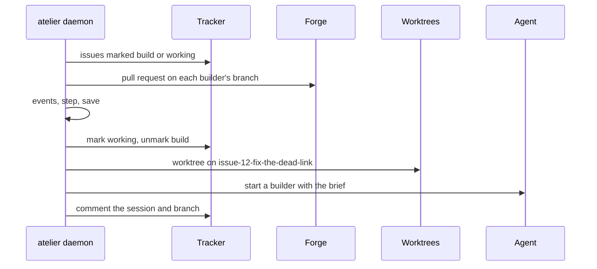
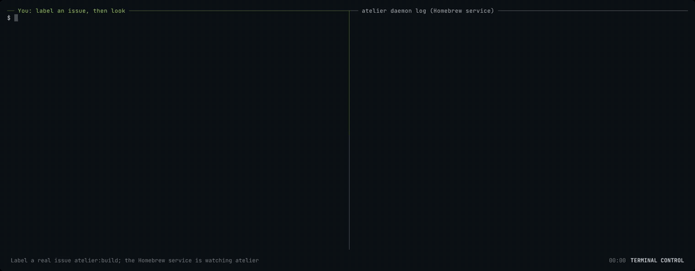

# Slice 1: a label becomes a ready pull request

**Status: Implemented, `0.1.0-rc.6`.** The core, `crates/git`, the `github`
plugin ([#6](https://github.com/StevenJPx2/atelier/issues/6)), the `opencode`
plugin ([#7](https://github.com/StevenJPx2/atelier/issues/7)), and the CLI
and daemon are built and released, and the [end-to-end runs](#end-to-end) on
atelier and Chauffeur pass.

You can label an issue `atelier:build` in a watched project and, within a
poll, find a builder working on it in its own worktree. It opens a draft pull
request, fixes what CI reports, and marks it ready once atelier tells it every
check passed.

```sh
gh issue edit 12 --add-label atelier:build
# a poll later: atelier:working, and a comment naming the session and branch
```



## Recording

The Homebrew service, rc.3, claims a real issue: atelier
[#16](https://github.com/StevenJPx2/atelier/issues/16) is labelled
`atelier:build` in the left pane, and the right pane follows the daemon's
log. Under launchd, git in `~/Documents` waits on macOS's folder prompt; once
it is allowed, the next poll claims the issue and starts a builder. The left
pane then shows the swapped labels, the comment naming the session and branch,
and the worktree on its branch.

The terminal-control capture is the real service and the real issue, with the
wait for the prompt sped up 2400 times. The GIF is 1200 pixels wide, 47.8
seconds and 966 KB; it links to the H.264 original, 1600 pixels wide and
264 KB. Frames from its beginning, middle and end are inspected for private
data.

[](../../media/slice-1.mp4)

## What it builds

### The core (`crates/core`)

The issue machine, the events a poll means, one poll's `observe` and `act`,
the roles plugins fill and the registry they fill them in. No I/O and no
dependencies.

Files: [`crates/core/src/`](../../../crates/core/src), with a README in each
of `machine/`, `poll/` and `roles/`, and the contract in
`crates/core/prompts/builder.md`.

```rust
let limits = Limits::new(5, [("critic", 2)])?;

let (next, actions) = step(Phase::Open { rounds: 4 }, Event::RoundFailed, &pipeline);
// → Blocked(RedRounds), [Interrupt, Unmark(Working), Mark(Blocked), Comment(RedRounds)]

let observation = observe(&project, &plugins, &state)?;

let report = act(&observation, &mut state, &project, &plugins, &mut save)?;
// report.steps → [Step { key: github#12, from: Untracked, to: Claiming }, …]
```

#### Structure

A phase is where one issue is; an event is what a poll saw or an action
confirmed. `rounds` counts failed CI rounds and `index` is a stage's
position. `is_working` holds from Claiming to Ready, `has_builder` from
Building and `has_pull_request` from Open.

```rust
pub enum Phase {
    Untracked,
    Claiming,
    Preparing,
    Starting,
    Building,
    Open { rounds: u8 },
    Stage { index: u8, rounds: u8 },
    Green { rounds: u8 },
    Ready { rounds: u8 },
    Done,
    Blocked(Reason),
    Stopped,
}

pub enum Reason { Start, RedRounds, Stage(u8), Closed, LostTrack }

pub enum Event {
    Requested,
    Claimed,
    WorktreeReady,
    AgentStarted,
    StartFailed,
    PullRequestOpened,
    Pushed,
    RoundFailed,
    AllPassed,
    StagePassed,
    StageFailed { rounds: u8 },
    MarkedReady,
    Merged,
    ClosedUnmerged,
    Unmarked,
    IssueClosed,
    LostTrack,
}

impl Phase {
    pub const fn is_working(self) -> bool;
    pub const fn has_builder(self) -> bool;
    pub const fn has_pull_request(self) -> bool;
    pub const fn rounds(self) -> u8;
}
```

A step names actions; marks show a person the phase, and each tracker maps
them to its labels. A pipeline refuses a limit of zero and more than eight
stages; `limit` is none past the last stage.

```rust
pub enum Mark { Build, Working, Blocked }

pub enum Action {
    Mark(Mark),
    Unmark(Mark),
    CreateWorktree,
    StartBuilder,
    CommentSession,
    StartStage(u8),
    Interrupt,
    TellGreen,
    CloseIssue,
    RemoveWorktree,
    Comment(Reason),
}

pub struct Limits {
    red_rounds: u8,
    limits: [u8; MAX_STAGES],
    count: u8,
    names: Vec<String>,
}

impl Limits {
    pub fn new<'a>(
        red_rounds: u8,
        stages: impl IntoIterator<Item = (&'a str, u8)>,
    ) -> Result<Self, LimitsError>;
    pub const fn red_rounds(&self) -> u8;
    pub const fn stages(&self) -> u8;
    pub fn stage_name(&self, index: u8) -> Option<&str>;
    pub fn limit(&self, index: u8) -> Option<u8>;
}

pub enum LimitsError { NoRedRounds, NoStageRounds { stage }, TooManyStages { count } }

pub fn step(phase: Phase, event: Event, limits: &Limits) -> (Phase, Vec<Action>);
```

`step` is one `match`. Every way out of a working phase removes the working
mark; every way out after Starting, except a merge, interrupts the builder.
Entering Green tells the builder so, since sourcefed suppresses passing
checks and nothing else would wake it to mark the pull request ready. An
interrupt is followed by a message saying why, and to act on nothing later:
sourcefed keeps waking the session with its pull request's events.
Requesting a blocked issue again also removes its blocked mark. Blocking adds
three actions: unmark working, mark blocked, and a comment saying why.

A poll's view of one issue becomes events, most urgent first: a merge, then a
closed issue or a removed working mark, then progress. Claiming hears none,
since the worker finishes a claim from its own record. A failed round is a
head commit with a failed check; a pending head after the pull request opened
is a push.

```rust
pub struct Marks { build: bool, working: bool, blocked: bool }

impl Marks {
    pub const fn has(self, mark: Mark) -> bool;
    pub const fn with(self, mark: Mark) -> Self;
    pub const fn without(self, mark: Mark) -> Self;
}

pub enum Rollup { Pending, Passed, Failed }

pub enum PullRequest {
    Open { number: u64, draft: bool, failed_rounds: u8, checks: Rollup },
    Merged { number: u64 },
    Closed { number: u64 },
}

pub enum StageOutcome { Passed, Failed { rounds: u8 } }

pub struct Seen {
    pub open: bool,
    pub marks: Marks,
    pub pull_request: Option<PullRequest>,
    pub stage: Option<StageOutcome>,
}

pub fn events(phase: Phase, seen: &Seen) -> Vec<Event>;
```

The roles. A tracker lists issues carrying a mark that match a filter, or
answers `Unchanged` when the tag still holds; marking, unmarking and closing
are idempotent. A plugin's failure says whether a retry can help.

```rust
pub struct Repo(pub String);

pub struct IssueKey { pub tracker: String, pub id: String }

pub struct Issue { pub key: IssueKey, pub title: String, pub open: bool, pub marks: Marks }

pub struct Filter {
    pub assignee: Option<String>,
    pub author: Option<String>,
    pub labels: Vec<String>,
    pub query: Option<String>,
}

pub enum Listing { Unchanged, Changed { issues: Vec<Issue>, etag: Option<String> } }

pub struct Session { pub id: String, pub title: String }

pub enum Failure { Transient, RateLimited { retry_after_secs: u64 }, Permanent }

pub struct PluginError { pub failure: Failure, pub message: String }

pub trait Tracker {
    fn issues(
        &self,
        repo: &Repo,
        mark: Mark,
        filter: &Filter,
        etag: Option<&str>,
    ) -> Result<Listing, PluginError>;
    fn issue(&self, repo: &Repo, id: &str) -> Result<Issue, PluginError>;
    fn mark(&self, repo: &Repo, id: &str, mark: Mark) -> Result<(), PluginError>;
    fn unmark(&self, repo: &Repo, id: &str, mark: Mark) -> Result<(), PluginError>;
    fn comment(&self, repo: &Repo, id: &str, text: &str) -> Result<(), PluginError>;
    fn close(&self, repo: &Repo, id: &str) -> Result<(), PluginError>;
    fn reference(&self, issue: &Issue) -> String;
    fn brief(&self, repo: &Repo, issue: &Issue) -> String;
}

pub trait Forge {
    fn pull_request(&self, repo: &Repo, branch: &str) -> Result<Option<PullRequest>, PluginError>;
    fn brief(&self, repo: &Repo, base: &str, branch: &str) -> String;
    fn denied(&self) -> Vec<String>;
}

pub trait Agent {
    fn start(
        &self,
        worktree: &Path,
        brief: &Brief,
        replacing: Option<&Session>,
    ) -> Result<Session, PluginError>;
    fn interrupt(&self, session: &Session) -> Result<(), PluginError>;
    fn tell(&self, session: &Session, text: &str) -> Result<(), PluginError>;
}

pub struct WorktreeRequest<'a> {
    pub repo: &'a Repo,
    pub local: &'a Path,
    pub name: &'a str,
    pub branch: &'a str,
    pub base: &'a str,
}

pub trait Worktrees {
    fn create(&self, request: &WorktreeRequest<'_>) -> Result<PathBuf, PluginError>;
    fn remove(&self, local: &Path, worktree: &Path) -> Result<(), PluginError>;
}
```

A plugin registers the roles it fills under its name. A tracker is
registered as a constructor, so each project builds its own from its
`[[tracker]]` settings; forges and agents are one instance each. A project
with no agent named takes the build's only one. Checks plugins register as
[slice 2](slice-2.md#the-checks-role-cratescore) shows.

```rust
pub trait Plugin {
    fn name(&self) -> &'static str;
    fn register<'a>(&'a self, registry: &mut Registry<'a>);
}

pub enum Role { Tracker, Forge, Agent, Checks }

pub struct MissingPlugin { pub role: Role, pub name: Option<String>, pub available: Vec<&'static str> }

impl<'a> MakeTracker<'a> {
    pub fn make(&self, settings: &Settings) -> Result<Box<dyn Tracker + 'a>, SettingsError>;
}

impl<'a> Registry<'a> {
    pub fn new(plugins: &[&'a dyn Plugin]) -> Self;
    pub fn tracker(
        &mut self,
        make: impl Fn(&Settings) -> Result<Box<dyn Tracker + 'a>, SettingsError> + 'a,
    );
    pub fn forge(&mut self, forge: &'a dyn Forge);
    pub fn agent(&mut self, agent: &'a dyn Agent);
    pub fn find_tracker(&self, name: &str) -> Result<&MakeTracker<'a>, MissingPlugin>;
    pub fn find_forge(&self, name: &str) -> Result<&'a dyn Forge, MissingPlugin>;
    pub fn find_agent(&self, name: Option<&str>) -> Result<&'a dyn Agent, MissingPlugin>;
}
```

A plugin's settings are plain values, so core needs no config format and each
plugin reads only its own keys. `only` fails on a key the plugin does not
know, so a misspelt setting is never quietly ignored; each error names its
dotted path, such as `labels.working.color`.

```rust
pub enum Setting { Text(String), Number(i64), Flag(bool), List(Vec<Self>), Table(Settings) }

pub struct Settings(BTreeMap<String, Setting>);

impl Settings {
    pub fn with(self, key: &str, value: Setting) -> Self;
    pub fn only(&self, path: &str, known: &[&str]) -> Result<(), SettingsError>;
    pub fn text(&self, path: &str, key: &str) -> Result<Option<&str>, SettingsError>;
    pub fn table(&self, path: &str, key: &str) -> Result<Option<&Self>, SettingsError>;
}

pub struct SettingsError { pub key: String, pub problem: String }
```

The brief is the contract filled in for one issue, then each plugin's part,
and the denied commands: `git tag *` and `git push * --tags` from core, and
the forge's own.

```rust
pub struct Brief {
    pub title: String,
    pub branch: String,
    pub parts: Vec<String>,
    pub denied: Vec<String>,
}

impl Brief {
    pub fn new(
        reference: &str,
        issue: &Issue,
        branch: &str,
        base: &str,
        limits: &Limits,
    ) -> Self;
    pub fn with(self, part: String) -> Self;
    pub fn deny(self, patterns: impl IntoIterator<Item = String>) -> Self;
    pub fn text(&self) -> String;
}
```

One poll. `observe` lists each tracker's issues marked build, with its
filter, and marked working, so an issue atelier never took is found; reads
every issue atelier is working on; and asks the forge for each builder's pull
request. `act` steps each issue at most 32 times, saving after each step
and each action. A step's actions wait in the record's `pending` list, so a
stop resumes at the next one. A permanent failure while starting blocks the
issue; any other failure leaves the action pending and is reported. The
listing tags are kept only when every issue succeeded.

```rust
pub struct Project { pub repo: Repo, pub local: PathBuf, pub base: String, pub limits: Limits }

pub struct Source<'a> { pub name: &'a str, pub tracker: &'a dyn Tracker, pub filter: Filter }

pub struct Plugins<'a> {
    pub trackers: Vec<Source<'a>>,
    pub forge: &'a dyn Forge,
    pub agent: &'a dyn Agent,
    pub worktrees: &'a dyn Worktrees,
}

pub struct State {
    pub issues: BTreeMap<IssueKey, Record>,
    pub etags: BTreeMap<(String, Mark), String>,
}

pub struct Record {
    pub phase: Phase,
    pub title: String,
    pub branch: String,
    pub worktree: Option<PathBuf>,
    pub session: Option<Session>,
    pub pull_request: Option<u64>,
    pub pending: Vec<Action>,
}

impl Record {
    pub fn new(key: &IssueKey, title: &str) -> Self;
    pub fn folder(key: &IssueKey) -> String;
}

pub struct Observation {
    pub issues: BTreeMap<IssueKey, Observed>,
    pub etags: BTreeMap<(String, Mark), String>,
}

pub struct Observed { pub issue: Issue, pub seen: Seen }

pub struct Report { pub steps: Vec<Step>, pub failures: Vec<(IssueKey, PluginError)> }

pub struct Step { pub key: IssueKey, pub from: Phase, pub to: Phase }

pub fn observe(
    project: &Project,
    plugins: &Plugins<'_>,
    state: &State,
) -> Result<Observation, PluginError>;

pub fn act<E>(
    observation: &Observation,
    state: &mut State,
    project: &Project,
    plugins: &Plugins<'_>,
    save: &mut impl FnMut(&State) -> Result<(), E>,
) -> Result<Report, E>;
```

A record's branch is `issue-<id>-<slug>`, the title's words in lowercase up
to 40 characters, and its worktree folder `issue-<id>`.

#### Verification

- **Kani**, four harnesses, one for each pipeline of zero to three stages,
  each limit 1 or 2 and `red_rounds` 1 to 5, over every phase and event.
  About 20 seconds each.

  ```text
  for all stages   = 0 to 3 stages, each with a limit of 1 to 2
  for all pipeline = red_rounds 1 to 5, with those stages
  for all phase    = every phase, rounds 0 to red_rounds, index 0 to stages - 1
  for all event    = every event, with stage rounds 0 to 2

  (next, actions) = step(phase, event, pipeline)

  assert actions has StartBuilder
         == (phase == Preparing and event == WorktreeReady)
  assert next == Starting, entered, implies phase == Preparing and event == WorktreeReady
  assert next == Claiming, entered, implies event == Requested
  assert working(phase) and not working(next) implies actions has Unmark(Working)
  assert has_builder(phase) and not working(next) and next != Done
         implies actions has Interrupt
  assert next == Green, entered,
         implies (phase == Stage(stages - 1) and event == StagePassed)
              or (phase == Open and event == AllPassed and stages == 0)
  assert actions has TellGreen == (next == Green, entered)
  assert event == Merged and has_pull_request(phase) implies actions has CloseIssue
  assert next.rounds <= red_rounds and next is Stage(i) implies i < stages
  assert next == phase implies actions is empty
  ```

- **Unit tests**: every arm of `step` and its guards, `events` for each
  phase, and the pipeline's limits and refusals.
- **Poll tests** against an in-memory tracker, forge, agent and worktrees: one
  builder across many polls; a stop after every save resumes to the same end;
  a transient failure retries and keeps the listing unconfirmed; a permanent
  start failure blocks; a blocked issue requested again keeps its branch; the
  working mark removed or the issue closed stops the builder and tells it to
  stand down; failed rounds block at the limit; passing checks tell the builder once per green, then
  ready and a merge close the issue and remove the worktree; a pull request closed unmerged blocks; an issue marked working that
  atelier never took is blocked; a finished issue is not read again.
- **Mutation testing** over `crates/core`.

```sh
cargo kani -p atelier-core
cargo nextest run -p atelier-core
cargo mutants -p atelier-core
```

### Worktrees (`crates/git`)

atelier's own bare clone of each project, under
`~/.local/share/atelier/clones/<owner>/<repo>.git`, and a worktree for each
issue under `~/.local/share/atelier/worktrees/<owner>/<repo>/issue-<n>`, on
the issue's branch: reused when it is there, made from the local branch, the
branch on `origin`, or a new branch from `origin/<base>`. Neither is in a
folder macOS guards, such as `~/Documents`, so the daemon never waits on its
folder prompt.

Files: [`crates/git/`](../../../crates/git/README.md).

```rust
let repo = Repo("StevenJPx2/chauffeur".into());
let local = Repository::under(Path::new("/Users/me/.local/share/atelier/clones"), &repo)?;
local.create("https://github.com/StevenJPx2/chauffeur.git")?;
// → /Users/me/.local/share/atelier/clones/StevenJPx2/chauffeur.git, bare

let git = Git::new("/Users/me/.local/share/atelier/worktrees");

let tree = git.create(&WorktreeRequest {
    repo: &repo,
    local: local.path(),
    name: "issue-12",
    branch: "issue-12-fix-the-dead-link",
    base: "v2",
})?;
// → /Users/me/.local/share/atelier/worktrees/StevenJPx2/chauffeur/issue-12
```

#### Structure

`Repository` is a project's local repository: atelier's clone, or your
checkout for `atelier init`. `create` makes a bare repository with `origin`
and fetches nothing; each branch is fetched when needed into
`origin/<branch>`, and its only local branches are the issues'. A clone with
another `origin` is refused.

```rust
pub struct Repository {
    path: PathBuf,
}

impl Repository {
    pub fn new(path: impl Into<PathBuf>) -> Self;
    pub fn under(root: &Path, repo: &Repo) -> Result<Self, PluginError>;
    pub fn path(&self) -> &Path;
    pub fn exists(&self) -> bool;
    pub fn create(&self, url: &str) -> Result<(), PluginError>;
    pub fn origin(&self) -> Result<String, PluginError>;
    pub fn default_branch(&self) -> Result<String, PluginError>;
    pub fn fetch(&self, branch: &str) -> Result<(), PluginError>;
    pub fn show(&self, branch: &str, path: &str) -> Result<Option<String>, PluginError>;
}
```

`Git` fills core's `Worktrees` role. A worktree already on another branch
is refused; a local branch is never reset; removing forces out what the
builder left and keeps the branch, running git inside the worktree so one
made from your checkout before atelier kept its own clone goes too. A
repository that is not `owner/name`, or a part that could leave the root, is
refused.

```rust
pub struct Git {
    root: PathBuf,
}

impl Git {
    pub fn new(root: impl Into<PathBuf>) -> Self;
}

impl Worktrees for Git {}
```

Each `git` call has a 120-second deadline and `GIT_TERMINAL_PROMPT=0`, through
[`atelier-command`](#running-tools-cratescommand). Reaching `origin` fails
transiently; anything else fails permanently.

```rust
fn git(dir: &Path, args: &[&str]) -> Result<Output, PluginError>;
fn checked(dir: &Path, args: &[&str]) -> Result<String, PluginError>;
```

#### Verification

Tests against real repositories: a bare `origin` with `v2`, and atelier's
bare clone of it, made as the daemon makes it. The clone is bare, has its
`origin` and no branch, and another `origin` is refused. A new branch starts
from the newest `origin/v2` and is reused;
a local branch keeps its commits; a branch only on `origin` is continued and
tracked; a folder on another branch is refused; removing drops the worktree
and its changes, keeps the branch, and succeeds twice; a worktree made from
your checkout is removed too; names that could leave the root are refused,
for worktrees and clones. Only remote failures are transient.

```sh
cargo nextest run -p atelier-git
```

### Running tools (`crates/command`)

`git`, `gh` and `opencode` each run through one runner, so a hung tool never
holds up a poll.

Files: [`crates/command/src/lib.rs`](../../../crates/command/src/lib.rs).

```rust
let mut command = Command::new("git");
command.arg("--version");

let output = atelier_command::run(command, Duration::from_secs(10))?;
// → Output { success: true, stdout: "git version 2.56.0\n", stderr: "" }
```

#### Structure

A command runs with no input in its own process group. On its deadline the
whole group is killed, so a child it started cannot hold the output open, and
the failure is transient. Each output is read to its end, so a tool that
prints a lot runs on, and its last 1 MiB is kept, with bytes that are not
UTF-8 replaced.

```rust
pub struct Output {
    pub success: bool,
    pub stdout: String,
    pub stderr: String,
}

pub fn run(command: Command, deadline: Duration) -> Result<Output, PluginError>;
```

#### Verification

A command past its deadline is killed with its children within the deadline;
output stops at its bound; a missing tool fails transiently.

### The `github` plugin (`plugins/github`)

GitHub as tracker and forge, through `gh` ([#6](https://github.com/StevenJPx2/atelier/issues/6)).
Its CI part, `gates.yml`, comes with slice 2.

Files: [`plugins/github/`](../../../plugins/github/README.md).

```rust
let github = GitHub::new();
let repo = Repo("StevenJPx2/chauffeur".into());
let mine = Filter { assignee: Some("StevenJPx2".into()), ..Filter::default() };

let listing = github.issues(&repo, Mark::Build, &mine, Some(etag))?;
// → Listing::Unchanged, from a 304

github.mark(&repo, "12", Mark::Working)?;

let pull = github.pull_request(&repo, "issue-12-fix-the-dead-link")?;
// → Some(PullRequest::Open { number: 31, draft: true, failed_rounds: 1, checks: Passed })
```

#### Structure

`GitHub` runs `gh` from `PATH`, or another program, such as a stand-in in
tests. It registers as `github`, the name its issue keys carry: as a forge
itself, and as a tracker through `tracker`, which builds one project's
`GitHubTracker` from its `[[tracker]]` settings. `create_labels` makes that
project's labels with `gh label create --force`.

```rust
pub struct GitHub {
    program: PathBuf,
}

impl GitHub {
    pub fn new() -> Self;
    pub fn with_program(program: impl Into<PathBuf>) -> Self;
    pub fn tracker(&self, settings: &Settings) -> Result<GitHubTracker, SettingsError>;
}

pub struct GitHubTracker {
    program: PathBuf,
    labels: Labels,
}

impl GitHubTracker {
    pub const fn labels(&self) -> &Labels;
    pub fn create_labels(&self, repo: &Repo) -> Result<(), PluginError>;
}

impl Plugin for GitHub {}
impl Forge for GitHub {}
impl Tracker for GitHubTracker {}
```

Each mark is a label, and so is `improvement`, for a critic's findings that do
not block. A project sets any of them in its `[[tracker]]`; what it leaves
out keeps atelier's own. A name must not be empty and a color must be six hex
digits; an unknown key is refused.

```toml
# .atelier/config.toml
[[tracker]]
plugin = "github"
labels.working = { name = "bot:working", color = "5319e7" }
```

```rust
pub struct Label {
    pub name: String,
    pub color: String,
    pub description: String,
}

pub struct Labels {
    pub build: Label,
    pub working: Label,
    pub blocked: Label,
    pub improvement: Label,
}

impl Labels {
    pub fn from_settings(settings: &Settings) -> Result<Self, SettingsError>;
    pub const fn mark(&self, mark: Mark) -> &Label;
    pub const fn all(&self) -> [&Label; 4];
}
```

Every call is `gh api --include`, read whatever its status: a 304 is
unchanged; a 403 with `Retry-After` or no rate left, or a 429, waits that
long (60 seconds when GitHub does not say); a 5xx or no reply is transient;
any other error status is permanent. A listing reads at most ten pages and
keeps a tag only when it is one page. A filter's `query` uses search, with no
tag. Removing a label that is gone succeeds.

```rust
struct Reply {
    pub status: u16,
    pub headers: Vec<(String, String)>,
    pub body: String,
}

impl Reply {
    pub fn header(&self, name: &str) -> Option<&str>;
    pub fn next(&self) -> Option<&str>;
    pub fn ok(self, what: &str) -> Result<Self, PluginError>;
}
```

The forge asks one GraphQL query for the newest pull request on the branch,
with its last 100 commits' combined check state. A failed round is a commit
whose checks failed or errored; the head's checks are pending until they
report. The brief tells the builder to open the pull request as a draft,
watch it with a sourcefed `github` monitor and, once atelier tells it every
check passed, mark it ready with `gh pr ready`; `gh pr merge` and `gh release` are denied.

#### Verification

A stand-in `gh` replays replies captured from GitHub, listed in
[`fixtures/README.md`](../../../plugins/github/tests/github/fixtures/README.md):
one page keeps its tag and the same listing then answers 304; pages are
followed, pull requests dropped and no tag kept; a filter becomes the query
string; a query goes through search; a missing issue is permanent; a rate
limit waits 60 seconds, a refusal is final and an unreachable GitHub retries;
marks, comments and closing send what GitHub expects; labels are made once
each; a project's own labels are listed, set, made and briefed; a repository that is not `owner/name` is refused before any call; PR
#8's real history reads as merged, and open with one failed round; the brief
names GitHub's commands; the plugin registers under the name its issues carry.
Unit tests read every status and every pull request state. One test runs the
same reads against the real GitHub when `gh` is signed in; mutation testing
runs with it skipped, as CI does.

### The `opencode` plugin (`plugins/opencode`)

Each builder as an ordinary OpenCode session, started through `opencode api`
([#7](https://github.com/StevenJPx2/atelier/issues/7)).

Files: [`plugins/opencode/`](../../../plugins/opencode/README.md).

```rust
let opencode = OpenCode::new();

let session = opencode.start(&worktree, &brief)?;
// post /api/session {"title": "#12 Fix the dead link",
//                    "location": {"directory": "<worktree>"}, "permissions": [...]}
// post /api/session/ses_…/prompt {"text": "<the brief>"}
// → Session { id: "ses_…", title: "#12 Fix the dead link" }

opencode.tell(&session, "Every check passed on your pull request. …")?;
// post /api/session/ses_…/prompt {"text": "Every check passed …"}

opencode.interrupt(&session)?;
```

#### Structure

`OpenCode` runs `opencode` from `PATH`, which talks to its running server,
or another program in tests. It registers as the agent `opencode`. `start`
first lists the worktree's sessions (`get /api/session?directory=`) and
continues the one with the brief's title, other than the issue's last
builder, sending the brief only when it has no messages: a daemon stopped in
the middle of a start leaves one builder. Otherwise it makes the session,
and deletes one whose prompt fails. Interrupting or telling a session that
is gone (404) succeeds, since no builder is left to stop or tell. Each call
has a 30-second deadline; any other 4xx is permanent, anything else
transient.

```rust
pub struct OpenCode {
    program: PathBuf,
}

impl OpenCode {
    pub fn new() -> Self;
    pub fn with_program(program: impl Into<PathBuf>) -> Self;
}

impl Plugin for OpenCode {}
impl Agent for OpenCode {}
```

The brief's denials become permission rules, and the last matching rule
wins: its tools allowed; `git push *` denied, then `git push origin <branch>`
and its `-u` forms allowed; each denied command after that; the question tool
denied.

```rust
pub enum Effect { Allow, Deny }

pub struct Rule {
    pub action: String,
    pub resource: String,
    pub effect: Effect,
}

pub fn rules(brief: &Brief) -> Vec<Rule>;
```

#### Verification

A stand-in `opencode` replays what OpenCode v2.2.7 printed: a builder starts
as a session in its worktree with its rules, then gets its brief; a builder
already briefed in its worktree is continued, one made but never briefed gets
its brief, and neither the builder a start replaces nor a session titled for
another issue is continued; a session whose prompt fails is deleted; telling
or interrupting a session succeeds, and so does one that is gone; a reply
that is not a session, or a session list that is not one, is refused; it is
the build's agent under its name.

Once against the real OpenCode, on demand, since it starts a model turn: a
session in a temporary repository told to run `git push origin main`,
`gh pr merge 999999` and `git push origin issue-1-live` is refused the first
two with `Permission denied: shell`, `origin`'s `main` is unchanged, and its
own branch is pushed.

```sh
cargo nextest run -p atelier-opencode --run-ignored only
```

### The CLI and daemon (`crates/cli`)

The `atelier` binary: `init`, `add`, `daemon` and `status`. Each watched
project polls on its own thread; one writer owns `state.json`; a lock lets
one daemon run.

Files: [`crates/cli/`](../../../crates/cli/README.md).

```sh
atelier init
# StevenJPx2/chauffeur: labels atelier:build, atelier:working, atelier:blocked, improvement

atelier add StevenJPx2/chauffeur
# watching StevenJPx2/chauffeur, cloned in /Users/me/.local/share/atelier/clones/StevenJPx2/chauffeur.git

atelier status
# StevenJPx2/chauffeur  /Users/me/.local/share/atelier/clones/StevenJPx2/chauffeur.git
#   base        v2                       set
#   trackers    github                   found
#   forge       github                   found
#   agent       the only one             found
#   red_rounds  5                        found
#   poll        30 s                     found
#   github#6    Open { rounds: 1 }       issue-6-docs-fix-the-dead-commit-messages-link  ses_…  #8
#   github#12   Building                 issue-12-fix-the-dead-link  ses_…  -
```

Each issue's line shows its phase, branch, session and pull request, or `-`
for none. The pull request's number is the one the daemon's last poll saw,
kept in `state.json`, so `status` asks no forge.

#### Structure

The project's config is read from `origin`: its default branch for `base`,
and `origin/<base>` for the rest, so a branch cannot change its limits. Each
setting has a default found from the clone: the tracker and forge from
`origin`'s host, the only agent in the build, `red_rounds` 5, `poll` 30 s
(at least 15). A `[[tracker]]` entry's `plugin` and `filter` are atelier's;
the rest are the plugin's settings. Your filter in `projects.toml` and the
project's both apply; two different assignees or authors are refused. Checks
and stages are refused by name until their plugins exist.

```rust
pub enum Origin { Found, Set }

pub struct TrackerSpec {
    pub plugin: String,
    pub filter: atelier_core::Filter,
    pub settings: Settings,
}

pub struct Resolved {
    pub project: Project,
    pub trackers: Vec<TrackerSpec>,
    pub forge: String,
    pub agent: Option<String>,
    pub poll: Duration,
    pub shown: Vec<(&'static str, String, Origin)>,
}

pub fn resolve(entry: &Entry, local: &Repository) -> Result<Resolved>;
pub fn settings(table: toml::Table) -> Result<Settings>;
pub fn platform(url: &str) -> Result<&'static str>;
pub fn repo_from_url(url: &str) -> Option<String>;
```

Your projects, with your own filter for each tracker by plugin name. `add`
appends to the file and leaves the rest as written. A `path` to your
checkout, from before atelier kept its own clone, is accepted and not read.

```rust
pub struct Entry {
    pub repo: String,
    pub path: Option<PathBuf>,
    pub filter: BTreeMap<String, Filter>,
}

pub struct Filter {
    pub assignee: Option<String>,
    pub author: Option<String>,
    pub labels: Vec<String>,
    pub query: Option<String>,
}

impl Filter {
    pub fn and(&self, yours: &Self) -> Result<atelier_core::Filter>;
}

pub fn read(path: &Path) -> Result<Vec<Entry>>;
pub fn add(path: &Path, repo: &str) -> Result<()>;
```

Each project's clone. `add` makes it, and removes it again when the
repository cannot be reached; each poll makes it when it is missing or has
no `origin`, so a project added before has its clone from the next poll, and
one left between `git init` and `git remote add` is finished. The URL is GitHub's,
over the protocol `gh` uses, as `gh repo clone` does: HTTPS unless set to
SSH. `status` only reads it.

```rust
pub fn of(paths: &Paths, repo: &str) -> Result<Repository>;
pub fn ensure(paths: &Paths, repo: &str) -> Result<Repository>;

impl GitHub {
    pub fn clone_url(&self, repo: &Repo) -> Result<String, PluginError>;
}
```

`Build` holds one instance of each plugin crate; `plugins` builds a project's
trackers from their settings and finds its forge and agent by name. Two
trackers from one plugin are refused, since issue keys name the plugin.

```rust
pub struct Build {
    github: GitHub,
    opencode: OpenCode,
}

impl Build {
    pub fn new() -> Self;
    pub fn plugins(&self, resolved: &Resolved) -> Result<Built<'_>>;
}

impl Built<'_> {
    pub fn plugins<'b>(&'b self, git: &'b Git) -> Plugins<'b>;
}
```

The daemon. The supervisor rereads `projects.toml` every 5 s, starting a
thread for each new project and stopping one removed. A project's thread
polls every `poll` seconds, 5 s after acting, and on failure backs off as
long as a rate limit asks, otherwise 30 s doubling to 10 minutes. Each save
goes to the writer through a queue of 16 and waits up to 30 s for the file to
be written, so a phase is on disk before its actions run. `state.json` is
written to a temporary file and renamed. The lock holds the daemon's process
id, and a second daemon exits naming it.

```rust
pub fn run(paths: &Paths) -> Result<()>;

pub fn take(path: &Path) -> Result<File>;

pub struct Writer(SyncSender<Message>);

impl Writer {
    pub fn save(&self, repo: &str, state: &State) -> Result<()>;
    pub fn load(&self, repo: &str) -> Result<State>;
}

pub fn spawn(entry: Entry, paths: Paths, writer: Writer, stop: Arc<AtomicBool>) -> Result<JoinHandle<()>>;
```

#### Verification

Tests run the real binary with real git, a real `origin` reached as
`https://github.com/StevenJPx2/demo.git` through the sandbox home's
`insteadOf`, which sends every `https://github.com/` repository to a local
folder, and
stand-ins for `gh` and `opencode` first on `PATH`, built from their captured
replies; the `gh` stand-in keeps each issue's labels. A labelled issue gets
one builder across polls and a restart, on its own branch, with one comment,
and `status` shows it; `status` shows a builder's pull request without asking
GitHub; passing checks wake the builder with one prompt; removing the working
label interrupts the builder, then tells it to stand down; a second daemon refuses to start, naming the first;
an issue assigned to someone else is left alone under your filter; a builder
that cannot start blocks its issue; a plugin the build lacks fails that
project by name; `init` makes the labels the project sets; `add` makes a
bare clone with GitHub's URL, and refuses a repository it cannot reach,
leaving no clone, a name that could leave the root, and a second add; with an
entry from before, naming your checkout, the daemon makes its own clone and
works from it, and your checkout gains no worktree and no branch.

## End to end

Each run is a real issue on GitHub, labelled with the owner's approval, and
followed by the Homebrew service, as
[the plan](https://github.com/StevenJPx2/atelier/issues/1#end-to-end) lists.

| Run                                                                                                                             | What happens                                                                                                                                                                                                                                                                                                      |
| ------------------------------------------------------------------------------------------------------------------------------- | ----------------------------------------------------------------------------------------------------------------------------------------------------------------------------------------------------------------------------------------------------------------------------------------------------------------- |
| [atelier#16](https://github.com/StevenJPx2/atelier/issues/16) → [#17](https://github.com/StevenJPx2/atelier/pull/17)            | Claimed within a poll. The builder's pull request fails mutation testing; the failure reaches it through sourcefed, it fixes the cause, and the next push passes. The merge closes the issue and removes the worktree.                                                                                            |
| [atelier#19](https://github.com/StevenJPx2/atelier/issues/19)                                                                   | Removing `atelier:working` mid-turn stops the builder within a poll: its turn is aborted and nothing is pushed.                                                                                                                                                                                                   |
| [atelier#20](https://github.com/StevenJPx2/atelier/issues/20) → [#21](https://github.com/StevenJPx2/atelier/pull/21)            | Five red rounds block the issue: `atelier:blocked` replaces `atelier:working`, atelier comments why, and the builder stands down.                                                                                                                                                                                 |
| [chauffeur#6](https://github.com/StevenJPx2/chauffeur/issues/6) → [chauffeur#8](https://github.com/StevenJPx2/chauffeur/pull/8) | Chauffeur's whole config is `base = "v2"`: the worktree starts from `origin/v2` and the pull request goes into `v2`. The site build and every check pass; atelier tells the builder, which marks it ready 18 seconds later. The merge into `v2`, not the default branch, still closes the issue, through atelier. |

The runs shape three parts of the design. sourcefed suppresses passing
checks, so atelier tells the builder when every check passed
([#18](https://github.com/StevenJPx2/atelier/pull/18)). A pull request's
events still wake an interrupted builder, so atelier tells it to stand down
([#22](https://github.com/StevenJPx2/atelier/pull/22)). And under launchd,
git in a checkout in `~/Documents` waits on macOS's folder prompt, which
each release brings back, so the daemon works only from
[its own clones](https://github.com/StevenJPx2/atelier/issues/1#ateliers-own-clones).
