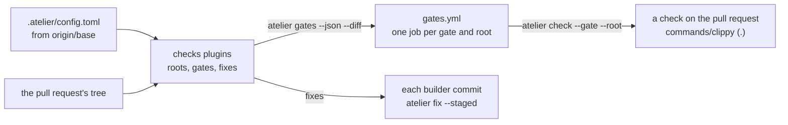

# Slice 2: run a project's gates

**Status: In progress.** The checks role in core and the `commands` plugin
are built. Next come running gates, the commit hook, GitHub's CI, and
atelier checking itself.

You can see every gate a project runs, run them yourself, and have GitHub run
each as its own check on a pull request. Every commit a builder makes is
already formatted and lint-fixed. Until the language plugins of slices 3 to 5
find a project's gates by themselves, a project lists its gates as commands,
and atelier checks itself this way.

```toml
# .atelier/config.toml
checks = ["commands"]

[commands.clippy]
run = "cargo clippy --workspace --all-targets --locked -- -D warnings"
fix = "cargo clippy --fix --allow-dirty --allow-staged --workspace"

[commands.prettier]
root = "docs"
run = "npx --yes prettier@3.9.10 --check ."
fix = "npx --yes prettier@3.9.10 --write ."
```

```sh
atelier gates
# .     commands/clippy
# docs  commands/prettier

atelier check
# .     commands/clippy    pass    21 s
# docs  commands/prettier  fail     2 s   plans/README.md: code style issues
```



## What it builds

### The checks role (`crates/core`)

A checks plugin reads a project's tree and returns data: its roots, the
directories its gates run in, and each root's gates and fixes as shell
commands with their setup. Core picks the roots a diff touches, each file
belonging to the deepest root that holds it, and applies the project's
`[paths]` overrides, the deepest matching path winning. It does no I/O, so
it is tested with an in-memory tree.

Files: `crates/core/src/checks/`.

```rust
let tree = MemoryTree::new([("Cargo.toml", "…"), ("docs/README.md", "…")]);
let changed = ["docs/README.md".to_owned()];

let planned = gates(&[("commands", &commands)], &tree, &overrides, Some(&changed));
// → one gate, commands/prettier in docs:
//   [Planned { plugin: "commands", root: Root("docs"), item: Gate { … } }]
```

```toml
# .atelier/config.toml
[paths."vendor"]
checks = []                     # nothing under vendor/ is checked

[paths."tools/codegen"]
skip = ["commands/mutants"]     # generated code
```

#### Structure

A plugin reads the tree and returns plain data. A root is a directory from
the top, `.` or a path without a trailing `/`. Each gate and fix is a
shell command run in its root; a fix shares its gate's name.

```rust
pub trait Tree {
    fn files(&self) -> Vec<String>;
    fn read(&self, path: &str) -> Option<String>;
}

pub struct MemoryTree(BTreeMap<String, String>);

impl MemoryTree {
    pub fn new<'a>(files: impl IntoIterator<Item = (&'a str, &'a str)>) -> Self;
}

impl Tree for MemoryTree {}

pub struct Root(pub String);

pub struct Gate {
    pub name: String,
    pub setup: Vec<String>,
    pub run: String,
}

pub struct Fix {
    pub name: String,
    pub run: String,
}

pub trait Checks {
    fn roots(&self, tree: &dyn Tree) -> Vec<Root>;
    fn gates(&self, tree: &dyn Tree, root: &Root) -> Vec<Gate>;
    fn fixes(&self, tree: &dyn Tree, root: &Root) -> Vec<Fix>;
}
```

`gates` plans every root with no diff; with one, each changed file touches
the deepest roots that hold it, counting only plugins that run at that file.
An override's `checks` keeps only the plugins it names in its subtree, and
its `skip` drops gates and fixes by full name there. The deepest override
holding a path is the one that applies. Results come in order of root, then
plugin, then each plugin's own order.

```rust
pub struct Override {
    pub checks: Option<Vec<String>>,
    pub skip: Vec<String>,
}

pub struct Overrides(pub BTreeMap<String, Override>);

pub struct Planned<T> {
    pub plugin: String,
    pub root: Root,
    pub item: T,
}

impl Planned<Gate> {
    pub fn name(&self) -> String;
}

impl Planned<Fix> {
    pub fn name(&self) -> String;
}

pub fn gates(
    plugins: &[(&str, &dyn Checks)],
    tree: &dyn Tree,
    overrides: &Overrides,
    changed: Option<&[String]>,
) -> Vec<Planned<Gate>>;

pub fn fixes(
    plugins: &[(&str, &dyn Checks)],
    tree: &dyn Tree,
    overrides: &Overrides,
    files: &[String],
) -> Vec<Planned<Fix>>;
```

A checks plugin registers how to build itself from a project's settings,
and where it runs: in every project, as a language plugin does, or only
where the project names it. `find_checks` returns the found plugins, then
the named ones in the project's order, refusing a name the build lacks.

```rust
pub enum On { Found, Named }

impl<'a> MakeChecks<'a> {
    pub const fn on(&self) -> On;
    pub fn make(
        &self,
        settings: &Settings,
    ) -> Result<Box<dyn Checks + 'a>, SettingsError>;
}

impl<'a> Registry<'a> {
    pub fn checks(
        &mut self,
        on: On,
        build: impl Fn(&Settings) -> Result<Box<dyn Checks + 'a>, SettingsError>
            + 'a,
    );
    pub fn find_checks(
        &self,
        named: &[String],
    ) -> Result<Vec<(&'static str, &MakeChecks<'a>)>, MissingPlugin>;
}
```

The pull request's check state, the enum `Rollup` (`Pending`, `Passed`,
`Failed`), takes GitHub's name, leaving `Checks` to the role.

#### Verification

Tests through core's API with plugins whose roots and gates are fixed: a
file touches the deepest roots that hold it, and `docsite/` is not inside
`docs`; with no diff every root runs, in order; an empty diff runs nothing;
`checks = []` empties a subtree, even for a root above it; `checks` keeps
the plugins it names; `skip` drops a gate and the deepest override wins;
fixes follow the files and the overrides; a plugin finds its roots and reads
its manifests through the tree; found plugins always run, named
ones only when named, and an unknown name is refused. A doc test plans one
root of two. Mutation testing over the diff: 68 mutants, 53 caught, 15
unviable.

### The `commands` plugin (`plugins/commands`)

The project names its gates as commands, each with an optional `root`
(default `.`), `fix` and `setup`. It finds nothing by itself, so a
project turns it on in `checks`. A gate is named `commands/<name>`. When
there is a diff, its base is in `ATELIER_BASE`, so a gate such as mutation
testing can test only the diff:

```toml
[commands.mutants]
run = '''
[ -z "$ATELIER_BASE" ] && exit 0
diff=$(mktemp) && git diff "$ATELIER_BASE" > "$diff"
cargo mutants --in-diff "$diff"
'''
```

Files: [`plugins/commands/`](../../../plugins/commands/README.md).

#### Structure

`Commands` registers as a checks plugin that runs only where a project
names it. `Listed` is one project's gates, read from its `[commands]`
table: each key a gate, in order of name. A gate's name takes letters,
digits, `-` and `_`; its `root` is a folder inside the project, with no
`.`, `..` or empty part; `run` must hold a command. Roots come once each,
leaving out a folder with no files; a fix carries its gate's name.

```rust
pub struct Commands;

impl Plugin for Commands {}

pub struct Listed {
    commands: Vec<Command>,
}

impl Listed {
    pub fn from_settings(settings: &Settings) -> Result<Self, SettingsError>;
}

impl Checks for Listed {}
```

Core's `Settings` reads a list of text, for `setup`, and gives its keys in
order.

```rust
impl Settings {
    pub fn texts(&self, path: &str, key: &str) -> Result<Vec<&str>, SettingsError>;
    pub fn iter(&self) -> impl Iterator<Item = (&str, &Setting)>;
}
```

#### Verification

Tests through the plugin's API, the registry and core's `gates`: each gate
runs in its root with its setup and fix, a root with no files is left out,
and `site` does not hold `sitemap.xml`; it runs only where a project names
it, and a change under `docs` plans the two `docs` gates; each refusal names
its path: a gate that is not a table, a name with a space, an unknown key, a
missing or blank `run`, a mistyped `setup` or `fix`, and six roots that
leave the project or are not plain folders. A doc test reads one gate.
Mutation testing over the diff: 35 mutants, 27 caught, 8 unviable.

### Running gates (`crates/cli`)

Three commands, run in a checkout. The gates come from the project's config
as the daemon reads it, from `origin/<base>`, so a pull request cannot drop
the gate it fails; the roots come from the checkout's own tree, so a new root
is checked in the pull request that adds it.

```sh
atelier gates --json --diff origin/main
# [{"gate":"commands/clippy","root":"."}]

atelier check --setup --gate commands/clippy --root .
# .  commands/clippy  pass  21 s

atelier fix --staged
# .  commands/clippy  fixed  src/lib.rs
```

- `gates` lists each root and its gates; `--diff <base>` keeps those whose
  root the diff from `<base>` touches.
- `check` runs them, by default those the changes from `origin/<base>`
  touch, committed or not. Each runs as `sh -c` in its root, after its setup
  with `--setup`, within 60 minutes. A failure prints the end of its output,
  and any failure exits 1.
- `fix` runs the fixes of the roots its files touch: the staged files with
  `--staged`, or the files given.

Files: `crates/cli/src/gates.rs`, `crates/cli/src/commands.rs`.

Verified through the real binary in temporary repositories with real git: a
diff touching one root of two plans that root alone; a failing gate exits 1
and prints its output; `--setup` runs setup first; `--json` prints the
matrix; an override shows in `gates`; a gate added on the pull request's
branch is not run until it is on the base.

### Fixes before each commit (`crates/git`, `crates/cli`)

When atelier makes a builder's worktree, it gives that worktree alone a
pre-commit hook, through Git's per-worktree config, so every commit the
builder makes is already fixed and the builder does nothing for it.

```sh
git -C <worktree> config extensions.worktreeConfig true
git -C <worktree> config --worktree core.hooksPath ~/.local/share/atelier/hooks
```

The daemon writes `~/.local/share/atelier/hooks/pre-commit` when it starts.
It runs `atelier fix --staged`, stages again the files the fixes changed,
and then runs the project's own pre-commit hook, from the repository's
`core.hooksPath` or its `hooks/pre-commit`. A staged file that also has
unstaged changes is left as staged, so no unstaged work slips into the
commit. A fix that fails is printed and does not stop the commit; the gate
fails in CI instead.

Files: `crates/git/src/worktree.rs`, `crates/cli/src/hook.rs`.

Verified in temporary repositories: an unformatted staged file is committed
formatted; a partly staged file is committed as staged; the project's hook
still runs; the checkout and other worktrees have no atelier hook.

### GitHub's CI (`plugins/github`, `.github/workflows/gates.yml`)

`atelier init` asks the forge for the project's CI. The `github` forge
writes a workflow that calls its reusable `gates.yml`, pinned to the commit
the running release was built from:

```yaml
# .github/workflows/atelier.yml
on: [pull_request, push]
jobs:
  gates:
    uses: StevenJPx2/atelier/.github/workflows/gates.yml@<commit>
    with:
      atelier: 0.1.0-rc.7
```

`gates.yml` installs atelier from that release, checking its sum, and reads
`atelier gates --json` into a matrix: on a pull request with
`--diff <base commit>`, on a push every root. It runs
`atelier check --setup --gate <gate> --root <root>` as one job each, named
`commands/clippy (.)`, so each shows as its own check, and a failure reaches
the builder through sourcefed. With `atelier: source`, it builds atelier
from the calling repository instead, as atelier's own CI does.

Files: `plugins/github/src/ci.rs`, `.github/workflows/gates.yml`.

Verified by tests of the workflow `init` writes, by `actionlint` on both
workflows, and on atelier's own pull requests.

### atelier checks itself (`.atelier/config.toml`)

atelier lists its gates as commands. Its only checking workflow is
`.github/workflows/atelier.yml`, which calls `gates.yml` from its own tree
with `atelier: source`, so a pull request that changes the gates runs them
as changed. The packaging smoke test on macOS and Linux checks the release,
not the code, and runs in `package.yml`.

- `.`: fmt, clippy, nextest, doc tests, rustdoc, deny, shear, mutants, msrv,
  kani
- `docs`: prettier
- `scripts`: ruff
- `.github`: actionlint

Verified by a pull request to atelier showing one check per gate and root,
and one that touches only `docs` running only `commands/prettier (docs)`.

## End to end

1. In atelier's checkout, `atelier gates` lists its gates, and
   `atelier check` runs the ones its changes touch.
2. A pull request to atelier shows one check per gate and root; a docs-only
   pull request runs only the docs gate.
3. A builder on a real atelier issue commits code the hook formats, so no
   format gate fails; a gate it does fail reaches it through sourcefed, and
   the next push passes.
4. `atelier init` in a fixture repository writes `atelier.yml`, and its
   pull request shows its gates as checks, run by the released atelier.
