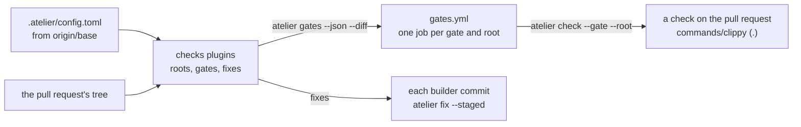
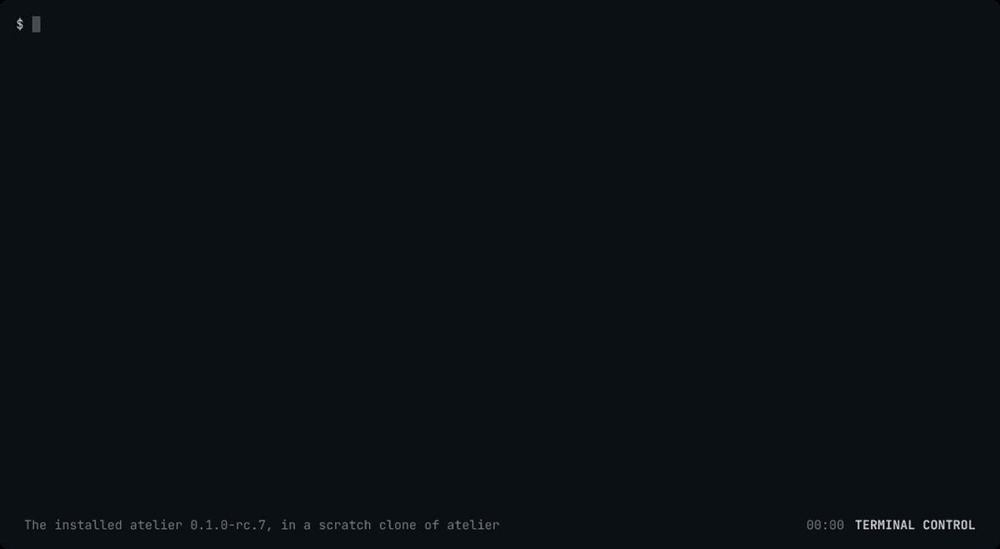

# Slice 2: run a project's gates

**Status: Implemented, `0.1.0-rc.7`.** Every part is built and released,
atelier checks itself with its own gates, and the [end-to-end runs](#end-to-end)
on atelier and on a fixture repository pass.

You can see every gate a project runs, run them yourself, and have GitHub run
each as its own check on a pull request. Every commit a builder makes is
already formatted and lint-fixed. Until the language plugins of slices 5 to 7
find a project's gates by themselves, a project lists its gates as commands,
and atelier checks itself this way.

```toml
# .atelier/config.toml
checks = ["commands"]

[commands.clippy]
run = "cargo clippy --workspace --all-targets --locked -- -D warnings"
fix = "cargo clippy --fix --allow-dirty --allow-staged --workspace"

[commands.prettier]
root = "docs"
run = "npx --yes prettier@3.9.10 --check ."
fix = "npx --yes prettier@3.9.10 --write ."
```

```sh
atelier gates
# .     commands/clippy
# docs  commands/prettier

atelier check
# docs  commands/prettier  fail     1.6 s
#     [warn] plans/README.md
#     [warn] Code style issues found in the above file. Run Prettier with --write to fix.
```



## Recording

The installed `0.1.0-rc.7`, in a scratch clone of atelier: `atelier gates`
lists its 14 gates. A table that is not formatted is added under `docs/`, so
`atelier check` runs only the docs gate, which fails and prints why;
`atelier fix` fixes the file and the check passes. Last, the fixture
repository's pull request, whose CI is the workflow `atelier init` wrote,
shows each gate as its own check.

The terminal-control capture is 39.9 seconds, 1600 pixels wide and 156 KB
as H.264; the GIF is 1200 pixels wide and 775 KB. Frames from its middle and
end are inspected for private data.

[](../../media/slice-2.mp4)

## What it builds

### The checks role (`crates/core`)

A checks plugin reads a project's tree and returns data: its roots, the
directories its gates run in, and each root's gates and fixes as shell
commands with their setup. Core picks the roots a diff touches, each file
belonging to the deepest root that holds it, and applies the project's
`[paths]` overrides, the deepest matching path winning. It does no I/O, so
it is tested with an in-memory tree.

Files: `crates/core/src/checks/`.

```rust
let tree = MemoryTree::new([("Cargo.toml", "…"), ("docs/README.md", "…")]);
let changed = ["docs/README.md".to_owned()];

let planned = gates(&[("commands", &commands)], &tree, &overrides, Some(&changed));
// → one gate, commands/prettier in docs:
//   [Planned { plugin: "commands", root: Root("docs"), item: Gate { … } }]
```

```toml
# .atelier/config.toml
[paths."vendor"]
checks = []                     # nothing under vendor/ is checked

[paths."tools/codegen"]
skip = ["commands/mutants"]     # generated code
```

#### Structure

A plugin reads the tree and returns plain data. A root is a directory from
the top, `.` or a path without a trailing `/`. Each gate and fix is a
shell command run in its root; a fix shares its gate's name.

```rust
pub trait Tree {
    fn files(&self) -> Vec<String>;
    fn read(&self, path: &str) -> Option<String>;
}

pub struct MemoryTree(BTreeMap<String, String>);

impl MemoryTree {
    pub fn new<'a>(files: impl IntoIterator<Item = (&'a str, &'a str)>) -> Self;
}

impl Tree for MemoryTree {}

pub struct Root(pub String);

pub struct Gate {
    pub name: String,
    pub setup: Vec<String>,
    pub run: String,
}

pub struct Fix {
    pub name: String,
    pub run: String,
}

pub trait Checks {
    fn roots(&self, tree: &dyn Tree) -> Vec<Root>;
    fn gates(&self, tree: &dyn Tree, root: &Root) -> Vec<Gate>;
    fn fixes(&self, tree: &dyn Tree, root: &Root) -> Vec<Fix>;
}
```

`gates` plans every root with no diff; with one, each changed file touches
the deepest roots that hold it, counting only plugins that run at that file.
An override's `checks` keeps only the plugins it names in its subtree, and
its `skip` drops gates and fixes by full name there. The deepest override
holding a path is the one that applies. Results come in order of root, then
plugin, then each plugin's own order.

```rust
pub struct Override {
    pub checks: Option<Vec<String>>,
    pub skip: Vec<String>,
}

pub struct Overrides(pub BTreeMap<String, Override>);

pub struct Planned<T> {
    pub plugin: String,
    pub root: Root,
    pub item: T,
}

impl Planned<Gate> {
    pub fn name(&self) -> String;
}

impl Planned<Fix> {
    pub fn name(&self) -> String;
}

pub fn gates(
    plugins: &[(&str, &dyn Checks)],
    tree: &dyn Tree,
    overrides: &Overrides,
    changed: Option<&[String]>,
) -> Vec<Planned<Gate>>;

pub fn fixes(
    plugins: &[(&str, &dyn Checks)],
    tree: &dyn Tree,
    overrides: &Overrides,
    files: &[String],
) -> Vec<Planned<Fix>>;
```

A checks plugin registers how to build itself from a project's settings,
and where it runs: in every project, as a language plugin does, or only
where the project names it. `find_checks` returns the found plugins, then
the named ones in the project's order, refusing a name the build lacks.

```rust
pub enum On { Found, Named }

impl<'a> MakeChecks<'a> {
    pub const fn on(&self) -> On;
    pub fn make(
        &self,
        settings: &Settings,
    ) -> Result<Box<dyn Checks + 'a>, SettingsError>;
}

impl<'a> Registry<'a> {
    pub fn checks(
        &mut self,
        on: On,
        build: impl Fn(&Settings) -> Result<Box<dyn Checks + 'a>, SettingsError>
            + 'a,
    );
    pub fn find_checks(
        &self,
        named: &[String],
    ) -> Result<Vec<(&'static str, &MakeChecks<'a>)>, MissingPlugin>;
}
```

The pull request's check state, the enum `Rollup` (`Pending`, `Passed`,
`Failed`), takes GitHub's name, leaving `Checks` to the role.

#### Verification

Tests through core's API with plugins whose roots and gates are fixed: a
file touches the deepest roots that hold it, and `docsite/` is not inside
`docs`; with no diff every root runs, in order; an empty diff runs nothing;
`checks = []` empties a subtree, even for a root above it; `checks` keeps
the plugins it names; `skip` drops a gate and the deepest override wins;
fixes follow the files and the overrides; a plugin finds its roots and reads
its manifests through the tree; found plugins always run, named
ones only when named, and an unknown name is refused. A doc test plans one
root of two. Mutation testing over the diff: 68 mutants, 53 caught, 15
unviable.

### The `commands` plugin (`plugins/commands`)

The project names its gates as commands, each with an optional `root`
(default `.`), `fix` and `setup`. It finds nothing by itself, so a
project turns it on in `checks`. A gate is named `commands/<name>`.
`atelier check` puts the base the changes are measured from in
`ATELIER_BASE`, so a gate such as mutation testing can test only them:

```toml
[commands.mutants]
run = '''
diff=$(mktemp) && git diff "$ATELIER_BASE" > "$diff"
cargo mutants --in-diff "$diff"
'''
```

Files: [`plugins/commands/`](../../../plugins/commands/README.md).

#### Structure

`Commands` registers as a checks plugin that runs only where a project
names it. `Listed` is one project's gates, read from its `[commands]`
table: each key a gate, in order of name. A gate's name takes letters,
digits, `-` and `_`; its `root` is a folder inside the project, with no
`.`, `..` or empty part; `run` must hold a command. Roots come once each,
leaving out a folder with no files; a fix carries its gate's name.

```rust
pub struct Commands;

impl Plugin for Commands {}

pub struct Listed {
    commands: Vec<Command>,
}

impl Listed {
    pub fn from_settings(settings: &Settings) -> Result<Self, SettingsError>;
}

impl Checks for Listed {}
```

Core's `Settings` reads a list of text, for `setup`, and gives its keys in
order.

```rust
impl Settings {
    pub fn texts(&self, path: &str, key: &str) -> Result<Vec<&str>, SettingsError>;
    pub fn iter(&self) -> impl Iterator<Item = (&str, &Setting)>;
}
```

#### Verification

Tests through the plugin's API, the registry and core's `gates`: each gate
runs in its root with its setup and fix, a root with no files is left out,
and `site` does not hold `sitemap.xml`; it runs only where a project names
it, and a change under `docs` plans the two `docs` gates; each refusal names
its path: a gate that is not a table, a name with a space, an unknown key, a
missing or blank `run`, a mistyped `setup` or `fix`, and six roots that
leave the project or are not plain folders. A doc test reads one gate.
Mutation testing over the diff: 35 mutants, 27 caught, 8 unviable.

### Running gates (`crates/cli`)

Three commands, run in a checkout. The gates come from the project's config
as the daemon reads it, from `origin/<base>`, so a pull request cannot drop
the gate it fails; the roots come from the checkout's own tree, so a new root
is checked in the pull request that adds it.

```sh
atelier gates --json --diff origin/main
# [{"gate":"commands/clippy","root":"."}]

atelier check --setup --gate commands/clippy --root .
# .  commands/clippy  pass    21.0 s

atelier fix --staged
# .  commands/clippy  fixed
```

- `gates` lists each root and its gates; `--diff <base>` keeps those whose
  root the changes since `<base>` touch.
- `check` runs the gates the changes since `origin/<base>` touch, committed
  or not, or one gate in one root with `--gate` and `--root`. Each runs as
  `sh -c` in its root, after its setup with `--setup`, within an hour, with
  the base in `ATELIER_BASE` (`--diff` names another). A failure prints the
  last 40 lines of its output, and any failure exits 1.
- `fix` runs the fixes of the roots its files touch: the files given, or
  the staged files with `--staged`, which are then staged again, except
  those with unstaged changes too. A failed fix exits 1.

Files: `crates/cli/src/gates.rs`, `crates/git/src/tree.rs`.

#### Structure

The three commands, each in a checkout. Each reads the project's settings
from `origin`, as the daemon does, and the checkout's working tree.

```rust
pub fn list(path: &Path, diff: Option<&str>, json: bool) -> Result<()>;

pub struct Selection<'a> {
    pub diff: Option<&'a str>,
    pub gate: Option<&'a str>,
    pub root: Option<&'a str>,
    pub setup: bool,
}

pub fn check(path: &Path, selection: &Selection<'_>) -> Result<ExitCode>;
pub fn fix(path: &Path, staged: bool, files: &[String]) -> Result<ExitCode>;
```

A working tree lists its files once, as git does: tracked, and untracked
unless ignored, from the top of the checkout. `changed` is every file
changed since a base: committed since the commit it shares with `HEAD`,
staged, unstaged or untracked. `read` refuses a path that leaves the tree.

```rust
pub struct WorkingTree {
    root: PathBuf,
    files: Vec<String>,
}

impl WorkingTree {
    pub fn read(folder: &Path) -> Result<Self, PluginError>;
    pub fn root(&self) -> &Path;
    pub fn changed(&self, base: &str) -> Result<Vec<String>, PluginError>;
    pub fn staged(&self) -> Result<Staged, PluginError>;
    pub fn stage(&self, files: &[String]) -> Result<(), PluginError>;
}

impl Tree for WorkingTree {}

pub struct Staged {
    pub files: Vec<String>,
    pub partly: Vec<String>,
}
```

The config names its checks plugins in `checks`, each with its own table,
and its overrides in `[paths."…"]`, each a folder inside the project. Any
other key is refused, so a misspelt table is never quietly ignored. The
build makes each plugin from its table; a setting it cannot use names its
path, such as `commands.fmt.run`.

```rust
pub struct CheckSpec {
    pub plugin: String,
    pub settings: Settings,
}

pub struct Resolved {
    pub checks: Vec<CheckSpec>,
    pub overrides: Overrides,
    …
}

impl Build {
    pub fn checks(
        &self,
        resolved: &Resolved,
    ) -> Result<Vec<(&'static str, Box<dyn Checks + '_>)>>;
}
```

#### Verification

Through the real binary, in a checkout whose gates are real shell commands:
`gates` lists each root and its gates, and the matrix for a change under
`docs` holds only the `docs` gate; `check` runs only the gates the changes
touch, and a failing one exits 1 and prints its output; one gate by name
runs, after its setup with `--setup`, with `ATELIER_BASE` set to
`origin/main` or to `--diff`'s
base, and an unknown one is refused; `fix --staged` fixes a staged file and
stages it again, and leaves a partly staged one as staged; a gate added on
the branch is not run until it is on the base. `status` refuses an unbuilt
checks plugin, a misspelt plugin table, a gate the plugin cannot use, and a
path outside the project. The working tree, against real repositories: it
lists tracked and untracked files but not ignored ones, from any folder of
the checkout; `changed` counts commits and every uncommitted change, and
refuses an unknown base; staged files are told apart from partly staged
ones; `read` stays inside the tree. A unit test accepts `.`, `docs` and
`tools/codegen` as override paths and refuses eight that are no folder
inside the project. Mutation testing over the diff: 63 mutants, 50 caught,
13 unviable.

### Fixes before each commit (`crates/git`, `crates/cli`)

When atelier makes a builder's worktree, it gives that worktree alone a
pre-commit hook, through Git's per-worktree config, so every commit the
builder makes is already fixed and the builder does nothing for it.

```sh
git -C <worktree> config extensions.worktreeConfig true
git -C <worktree> config --worktree core.hooksPath ~/.local/share/atelier/hooks
```

The daemon writes `~/.local/share/atelier/hooks/pre-commit` when it starts.
It runs `atelier fix --staged`, stages again the files the fixes changed,
and then runs the project's own pre-commit hook, from the repository's
`core.hooksPath` or its `hooks/pre-commit`. A staged file that also has
unstaged changes is left as staged, so no unstaged work slips into the
commit. A fix that fails is printed and does not stop the commit; the gate
fails in CI instead.

Files: `crates/git/src/worktree.rs`, `crates/cli/src/hook.rs`.

#### Structure

`Git` gives each worktree it makes or reuses the hooks folder, in that
worktree's own config. Turning on per-worktree config would make a bare
clone's shared `core.bare` apply to its worktrees, so it moves to the
clone's own `config.worktree` first, in an order that never leaves a
worktree reading it.

```rust
impl Git {
    pub fn with_hooks(self, hooks: impl Into<PathBuf>) -> Self;
}
```

The hook calls `atelier` from `PATH`, or the daemon's own binary when it is
not there. The daemon writes it at each start, so it calls the atelier
running.

```rust
pub fn write(hooks: &Path, exe: &Path) -> Result<PathBuf>;

impl Paths {
    pub fn hooks(&self) -> PathBuf;
}
```

#### Verification

Through the real binary: the daemon claims an issue and makes its worktree
with the hook; the project has its own hook, set as a hook manager sets it;
a commit in the worktree, with no `atelier` on `PATH`, is committed fixed,
the project's hook runs, and neither the checkout nor the clone gains a
hooks folder. Against real repositories: a worktree gets the hooks folder
and still works while the clone stays bare; a worktree made without it has
none; a reused worktree gets it; a worktree of a checkout gets it and the
checkout keeps its own. `fix --staged` leaving a partly staged file as
staged is verified with running gates.

### GitHub's CI (`plugins/github`, `.github/workflows/gates.yml`)

`atelier init` asks the forge for the project's CI. The `github` forge
writes a workflow that calls its reusable `gates.yml`, pinned to the commit
the running release was built from:

```yaml
# .github/workflows/atelier.yml
on:
  pull_request:
  push:
    branches: [main]
jobs:
  gates:
    uses: StevenJPx2/atelier/.github/workflows/gates.yml@<commit>
    with:
      atelier: 0.1.0-rc.7
```

`gates.yml` installs atelier from that release, checking its sum, and reads
`atelier gates --json` into a matrix: on a pull request with
`--diff <base commit>`, on a push every root. It runs
`atelier check --setup --gate <gate> --root <root>` as one job each, named
`commands/clippy (.)`, so each shows as its own check, and a failure reaches
the builder through sourcefed. With `atelier: source`, it builds atelier
from the calling repository instead, as atelier's own CI does.

Files: `plugins/github/src/ci.rs`, `.github/workflows/gates.yml`.

#### Structure

A forge names the files its CI needs to run a project's gates with one
release, on pull requests and on pushes to the base. A release build stamps
its commit through `ATELIER_COMMIT`, which `release.yml` sets; `init`
writes the forge's files only from a release build, and says why when it
writes none.

```rust
pub struct CiFile {
    pub path: String,
    pub text: String,
}

pub trait Forge {
    fn ci(&self, release: &str, commit: &str, base: &str) -> Vec<CiFile>;
    …
}
```

`gates.yml` has two jobs. `plan` installs atelier once, from the release
with its `SHA256SUMS` checked or built from source, passes it on as an
artifact, and writes the matrix. `gate` runs once per entry, without
stopping the others on a failure; it is skipped when the matrix is empty.
Both check out the full history, with credentials, since atelier fetches
the base branch to read the config.

#### Verification

The github plugin's workflow names the base, the pinned commit and the
release; `init` from a build with no release commit writes no CI and says
so; `write_ci` writes each file in its folder. `actionlint` passes on
`gates.yml`, on `release.yml` and on a written `atelier.yml`. The
workflow runs for real on atelier's own pull requests and in the end to end.

### atelier checks itself (`.atelier/config.toml`)

atelier lists its gates as commands. Its only checking workflow is
`.github/workflows/atelier.yml`, which calls `gates.yml` from its own tree
with `atelier: source`, so a pull request that changes `gates.yml` runs it
as changed. The gates themselves come from `main`'s config, as for any
project. The packaging smoke test on macOS and Linux checks the release,
not the code, and runs in `package.yml`. The site's build runs in
`docs.yml`, which deploys it.

```sh
atelier gates
# .        commands/clippy
# .        commands/deny
# …
# .github  commands/actionlint
# docs     commands/prettier
# scripts  commands/ruff
```

- `.`: clippy, deny, doctest, fmt, kani, msrv, mutants, nextest, readmes,
  rustdoc, shear. Only `fmt` has a fix, so a builder's commit is
  formatted without waiting on a build.
- `docs`: prettier, with its fix.
- `scripts`: ruff, with its fix.
- `.github`: actionlint.

Files: [`.atelier/config.toml`](../../../.atelier/config.toml),
`.github/workflows/atelier.yml`, `.github/workflows/package.yml`.

Verified with the real binary in a copy of atelier whose `main` holds the
config: `gates` lists the 14 gates, and `fmt`, `readmes`, `prettier`,
`ruff` and `actionlint` pass; a change under `docs` alone plans only
`commands/prettier (docs)`. Then on a pull request to atelier, one check per
gate and root.

## End to end

Each run is real: atelier's own pull requests, an issue labelled with the
owner's approval and followed by the Homebrew service, and a public fixture
repository created for the check.

| Run                                                                                                                  | What happens                                                                                                                                                                                                                                                                                                                                           |
| -------------------------------------------------------------------------------------------------------------------- | ------------------------------------------------------------------------------------------------------------------------------------------------------------------------------------------------------------------------------------------------------------------------------------------------------------------------------------------------------ |
| atelier's checkout                                                                                                   | `atelier gates` lists the 14 gates of `.atelier/config.toml`; `atelier check` runs only the gates the changes touch.                                                                                                                                                                                                                                   |
| [#35](https://github.com/StevenJPx2/atelier/pull/35), [#36](https://github.com/StevenJPx2/atelier/pull/36)           | #35 touches only `.github`, `docs` and `scripts`, and runs only their three gates. #36 touches the code and runs every gate, each as its own check, all passing.                                                                                                                                                                                       |
| [atelier#37](https://github.com/StevenJPx2/atelier/issues/37) → [#38](https://github.com/StevenJPx2/atelier/pull/38) | The builder writes `pub   const   E2E_HOOK :   u8 = 1 ;` and its commit holds `pub const E2E_HOOK: u8 = 1;`: the hook formatted it. A table row it was asked to leave as written fails `commands/readmes (.)`, which reaches it through sourcefed; it fixes the row, every gate passes, and atelier tells it so, 12 seconds before it marks #38 ready. |
| A fixture repository's first pull request                                                                            | `atelier init` from the `0.1.0-rc.7` release writes `atelier.yml` pinned to the release's commit. Its pull request installs that release, its sum checked; `commands/todo (notes)` fails on a TODO beside a passing `commands/readme (.)`, then passes after the fix.                                                                                  |

The first full run on `main` found a fault in the runs themselves: the
command runner closed a tool's output after its first MiB, so kani, which
prints more, was stopped on its next write, and the failure's reason was
never kept. Each output is read to its end and its last MiB kept
([#36](https://github.com/StevenJPx2/atelier/pull/36)).
