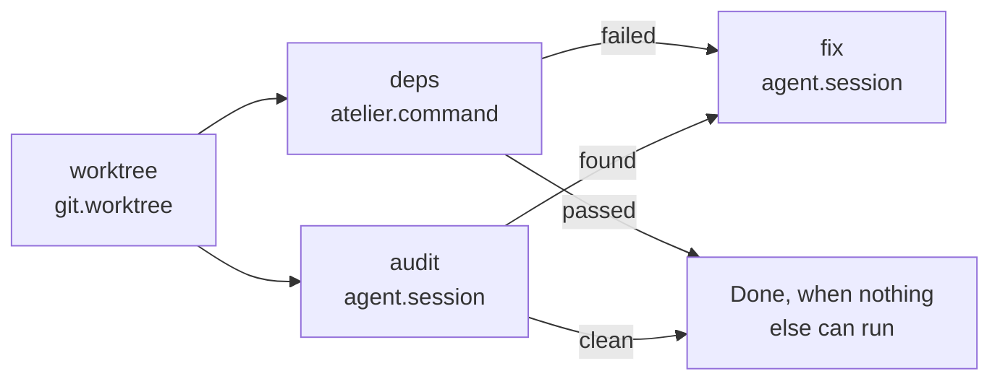
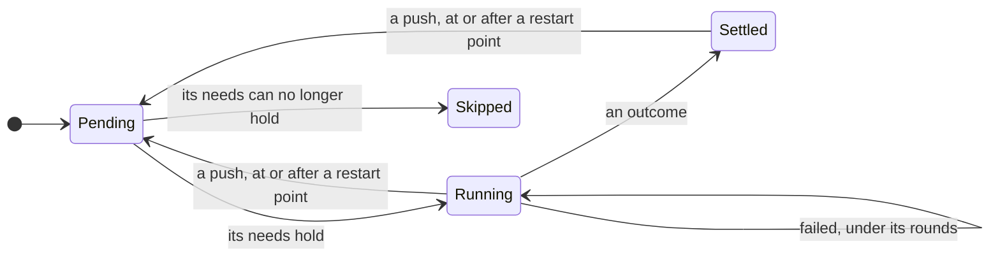

# Slice 3: pipelines made of steps

**Status: In progress.** The plan is
[#43](https://github.com/StevenJPx2/atelier/issues/43), slice 3 of
[#1](https://github.com/StevenJPx2/atelier/issues/1). The `sourcefed` trigger
follows as slice 4 ([#42](https://github.com/StevenJPx2/atelier/issues/42)).
The parts that need no machine come first; the machine moves to
[rungs](https://github.com/StevenJPx2/rungs) once its `v0.1.0` tag exists.

## You can

Give a project any number of pipelines, each a set of steps written in its
config. A step can be one a plugin provides, an agent with your own prompt, or a
shell command. Each step says which earlier outcomes it waits for, and steps
whose needs are met together run at the same time. Today's loop, from an issue
to a merged pull request, becomes the `build` pipeline, written in the same
terms.

For example, atelier adds `security-audit`. Labelling an issue
`atelier:security-audit` makes a worktree. Then `cargo deny` and an agent
following the audit prompt run side by side. If either finds something, a second
agent fixes it in a pull request. If both come back clean, the run is Done and
the issue closes with what was checked.

```toml
# atelier's .atelier/config.toml
[[pipeline.security-audit.step]]
id = "worktree"
uses = "git.worktree"

[[pipeline.security-audit.step]]
id = "deps"
uses = "atelier.command"
run = "cargo deny check advisories"
after = ["worktree"]

[[pipeline.security-audit.step]]
id = "audit"
uses = "agent.session"
prompt = ".atelier/prompts/security-audit.md"
outcomes = ["found", "clean"]
after = ["worktree"]

[[pipeline.security-audit.step]]
id = "fix"
uses = "agent.session"
prompt = ".atelier/prompts/fix-findings.md"
outcomes = ["opened"]
after_any = { audit = "found", deps = "failed" }
```



## What it builds

### Steps

Every step has the same shape:

| Key           | Meaning                                                                                                               | Default            |
| ------------- | --------------------------------------------------------------------------------------------------------------------- | ------------------ |
| `id`          | Its name in this pipeline                                                                                             | required           |
| `uses`        | The step kind, `<namespace>.<kind>`                                                                                   | required           |
| `after`       | Steps it waits for. A list means each of them passed; a table names the outcome each must have, or a list of outcomes | the step before it |
| `after_any`   | As `after`, but one is enough                                                                                         | none               |
| `outcomes`    | The outcomes it can settle with, besides `failed`                                                                     | the kind's own     |
| `rounds`      | How many times it may fail before the failure is final                                                                | 1                  |
| `restart`     | A push sends the run back here                                                                                        | false              |
| anything else | The kind's own settings, such as `prompt` or `run`                                                                    |                    |

- **`uses` names a role or a plugin.** `agent.session`, `forge.checks` and
  `tracker.comment` go to whichever plugin fills that role in the project, so a
  committed config works with any agent or forge. `opencode.session` or
  `github.checks` name one plugin, for a step that only works there. `atelier.*`
  are core's own kinds.
- **A step waits until every step it names has settled or been skipped,** then
  runs if its needs hold and is skipped if they don't. Steps that become ready
  together start together.
- **A failed step under its `rounds` starts again.** Its final failure goes to
  any step that names `failed` in its needs; if none does, the run blocks.
- **A run is Done** when no step is running and none can start. It closes the
  work item with a comment listing each step's outcome.
- **Resident steps,** an agent's session, stay alive after they settle, so later
  steps can talk to them, as `forge.ready` tells the builder every check passed.
  Every way out of a run interrupts them and tells them why.
- **Config is checked when it loads.** An unknown kind, a cycle, `after` naming
  a later or unknown step, an outcome the step can't settle with, or more than 8
  steps each refuse the pipeline with its name and the reason:
  `security-audit: no step kind "forge.reviews"; github has checks, ready, merge`.

### Step kinds

| Kind              | From                        | Starts by                                                                                                                                                  | Settles                                                                   |
| ----------------- | --------------------------- | ---------------------------------------------------------------------------------------------------------------------------------------------------------- | ------------------------------------------------------------------------- |
| `git.worktree`    | `git`                       | creating the run's worktree from `origin/<base>`                                                                                                           | `passed` when it exists                                                   |
| `agent.session`   | the agent role (`opencode`) | starting a resident session with `prompt`, read from `origin/<base>`, or `brief = "builder"`, core's builder contract with the tracker's and forge's parts | when the agent runs `atelier finish <outcome> "<why>"`                    |
| `atelier.command` | core                        | running `run` in the worktree, with a time limit                                                                                                           | `passed` on exit 0, otherwise `failed`                                    |
| `forge.checks`    | the forge role (`github`)   | nothing: CI runs on each push                                                                                                                              | `passed` when every check on the head passed, `failed` for a failed round |
| `forge.ready`     | the forge role              | telling the resident agent every check passed                                                                                                              | `passed` when the pull request is marked ready                            |
| `forge.merge`     | the forge role              | nothing: a person merges                                                                                                                                   | `merged`, or `failed` when closed unmerged                                |

A plugin adds kinds through the new `Step` role:

```rust
pub trait Step {
    /// The kinds this plugin offers, such as "checks" for "github.checks".
    fn kinds(&self) -> Vec<KindInfo>; // name, outcomes, resident

    /// Checks the step's own settings when the config loads.
    fn configure(&self, kind: &str, settings: &Table) -> Result<Configured, PluginError>;

    /// Starts the step for a run, or starts it again after a failed round.
    fn start(&self, run: &RunContext, step: &Configured) -> Result<(), PluginError>;

    /// What a poll sees: the outcome once the step settles.
    fn observe(&self, run: &RunContext, step: &Configured) -> Result<Option<Outcome>, PluginError>;
}
```

A future `critic` or `recording` plugin is one more set of kinds,
`critic.review` or `recording.record`, with nothing in core about it.

Files: `crates/core/src/pipeline/` (`Pipeline`, `StepSpec`, `Needs`, the config
check), `crates/core/src/roles/step.rs`, `crates/cli/src/command_step.rs`, and
each plugin's `steps.rs`.

### The `build` pipeline

Built in, and written in the same terms. A project that writes
`[pipeline.build]` replaces it:

```toml
[[pipeline.build.step]]
id = "worktree"
uses = "git.worktree"

[[pipeline.build.step]]
id = "builder"
uses = "agent.session"
brief = "builder"
outcomes = ["opened", "nothing"]  # `atelier finish opened` once the draft pull request is open

[[pipeline.build.step]]
id = "checks"
uses = "forge.checks"
after = { builder = "opened" }
rounds = 5
restart = true

[[pipeline.build.step]]
id = "ready"
uses = "forge.ready"

[[pipeline.build.step]]
id = "merge"
uses = "forge.merge"
```

With a critic and a recording, run side by side once the checks pass:

```toml
[[pipeline.build.step]]
id = "critic"
uses = "critic.review"
after = ["checks"]
rounds = 2

[[pipeline.build.step]]
id = "recording"
uses = "recording.record"
after = ["checks"]

[[pipeline.build.step]]
id = "ready"
uses = "forge.ready"
after = ["critic", "recording"]
```

`builder` settling `nothing` leaves no step able to run, so the run is Done: the
issue closes as not planned, with the builder's reason.

### Triggers and runs

- **A tracker's mark starts a run.** An item carrying `atelier:<pipeline>`
  starts that pipeline, so `atelier:build` keeps its meaning. `atelier init`
  creates a label for each pipeline. In this slice the tracker's listing finds
  them, as today; from slice 4 the trigger role does, with sourcefed's events
  ([#42](https://github.com/StevenJPx2/atelier/issues/42)), and the listing only
  reconciles.
- **A run** is one pass of a pipeline for one item, such as `build github#12`.
  It replaces "an issue" in `state.json` and `atelier status`. An item has at
  most one working run at a time.

### The machine

The step logic is [rungs](https://github.com/StevenJPx2/rungs)
([its plan](https://github.com/StevenJPx2/rungs/issues/1)), a crate shared with
Chauffeur: no I/O, no dependencies, `no_std`, proven with Kani. Core lowers a
pipeline to a `rungs::Plan`, saves each run's `rungs::Progress` in `state.json`,
and turns what rungs reports into actions:

```rust
let plan = pipeline.lower()?;              // rungs::Plan: positions, outcomes, needs, attempts
let mut run = plan.resume(saved.progress)?;    // the run's progress from state.json

run.settle(WORKTREE, PASSED)?;
let start = run.advance();                     // → [deps, audit]: in parallel
// core → [Start(deps), Start(audit)]

run.restart(CHECKS);                           // a push
// rungs::State::Over { unhandled: Some(i) } → Blocked at step i
```



- Each step is Pending, Running with its failed rounds, Settled with its
  outcome, or Skipped. The run is Claiming, Running, Done, Blocked at a step, or
  Stopped.
- A push resets each started restart step, and every step that depends on it, to
  Pending; failed rounds are kept, so CI rounds still add up across pushes.
- Stopping, blocking and Done each remove the working mark, interrupt every
  resident step that started, and remove the worktree.

rungs proves its own promises
([rungs#1](https://github.com/StevenJPx2/rungs/issues/1)). Core's Kani harness
adds, over rungs, for every pipeline of up to four steps, every need, every
status and every event:

- The machine returns, and an event that does not apply changes nothing.
- A step starts only when every step it names has settled or been skipped and
  its needs hold; it is skipped only when they cannot.
- A run never stalls: after any event, a step is running or the run is Done,
  Blocked or Stopped.
- Between two pushes, a step starts at most `rounds` times.
- Every way out of a run removes the working mark and interrupts each resident
  step that started.
- Done comes only when no step is running and none can start.

Tests with pipelines up to the limit of eight steps cover the rest, including
the recorded event sequences of slices 1 and 2: the written-out `build` gives
the same actions as today's machine.

Files: `crates/core/src/machine/`, rewritten over rungs, with `proofs.rs`. rungs
itself is built first, in its own repository, and tagged `v0.1.0`.

### `atelier finish` and `atelier stop`

```sh
# run by an agent step, in its worktree
atelier finish found "two advisories in toml_edit"
# run by a person
atelier stop "security-audit github#40"
```

Each finds the run by its worktree or key and leaves a request for the project's
thread, which reads it on its next poll. The daemon stays the only writer of
`state.json`. An agent's permissions allow `atelier finish *`, and `finish`
refuses an outcome the step doesn't declare.

Files: `crates/cli/src/requests.rs`, `finish.rs`, `stop.rs`.

### State from an older rc

`state.json` keeps each run's pipeline and every step's status. The new rc reads
an older file into the written-out `build`: Building is `builder` running; Open
is `builder` settled `opened` and `checks` running; Green is `ready` running;
and Ready is `merge` running.

### Verification

- Kani as above, and the config check's refusals, one test each.
- The recorded event sequences of slices 1 and 2, with the same actions.
- `atelier.command`: a passing command, a failing one, and one past its time
  limit.
- `atelier finish` and `atelier stop` against a running daemon in a temporary
  state folder.
- An older `state.json` read by the new daemon, with each run where it was.

## End to end

On the installed rc, on atelier:

1. **`build`, written out:** a small real issue goes from worktree to merge, as
   in slice 1.
2. **Parallel steps and outcomes:** `security-audit` on an issue. `deps` and
   `audit` start in the same poll. One run finds something real and `fix` opens
   a pull request; a later run with nothing left skips `fix` and closes the
   issue with each step's outcome.
3. **A plugin step by role:** `forge.checks` resolves to `github.checks`, as
   `atelier status` shows.
4. **The upgrade:** the daemon is upgraded from the previous rc while a `build`
   run is open, and the run continues.
5. **Stop:** `atelier stop` on a running audit interrupts both agents within a
   poll.

## Dependencies

| Crate         | Dependency                   | Why                                                                        |
| ------------- | ---------------------------- | -------------------------------------------------------------------------- |
| `crates/core` | `rungs`, by git tag `v0.1.0` | The step machine, shared with Chauffeur; it has no dependencies of its own |

The config is read with the CLI's `toml`.
