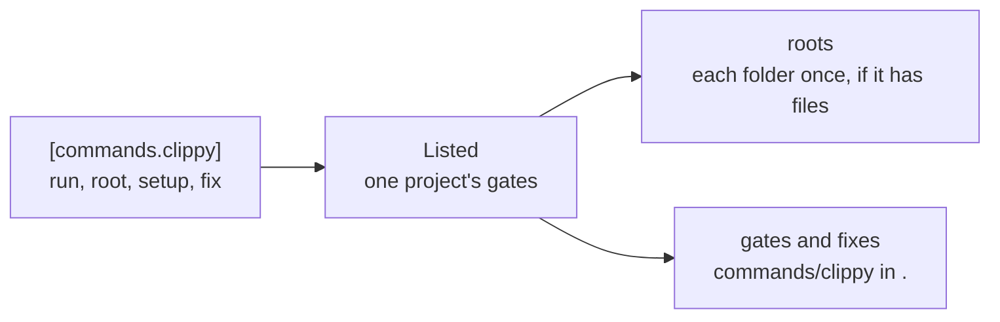

# The `commands` plugin

A project lists its gates as shell commands in `.atelier/config.toml`, and
turns the plugin on in `checks`. It finds nothing by itself, so it is how a
project has gates before a language plugin finds them, and how it adds gates
no plugin knows.

```toml
# .atelier/config.toml
checks = ["commands"]

[commands.clippy]
run = "cargo clippy --workspace --all-targets --locked -- -D warnings"
fix = "cargo clippy --fix --allow-dirty --allow-staged --workspace"

[commands.prettier]
root = "docs"
setup = ["npm install --global prettier@3.9.10"]
run = "prettier --check ."
fix = "prettier --write ."
```



| Key     | Holds                                                             |
| ------- | ----------------------------------------------------------------- |
| `run`   | The command that passes or fails; required                        |
| `root`  | The folder it runs in, inside the project; `.` when unset         |
| `setup` | Commands run first with `atelier check --setup`, such as installs |
| `fix`   | A command that fixes what `run` fails on, run before each commit  |

| File     | Holds                                                   |
| -------- | ------------------------------------------------------- |
| `lib.rs` | `Commands`, the plugin, and `Listed`, a project's gates |

- **Names.** A gate is `commands/<name>`, and its name takes letters, digits,
  `-` and `_`. Gates come in order of name.
- **Refusals.** An unknown key, a missing or blank `run`, or a `root`
  outside the project fails with its path, such as `clippy.run`.
