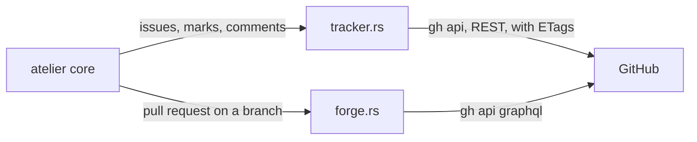

# The `github` plugin

GitHub fills two roles: tracker, for issues, and forge, for pull requests and
their checks. Every call goes through `gh`, so it carries the user's own
sign-in, and runs with a 30-second deadline.



| File         | Holds                                                               |
| ------------ | ------------------------------------------------------------------- |
| `lib.rs`     | `GitHub`, and `Plugin`: registers the tracker and the forge         |
| `api.rs`     | `gh api --include`: status, headers and body; rate limits; encoding |
| `tracker.rs` | Listing with ETags and pages, search, marks as labels, `LABELS`     |
| `forge.rs`   | One GraphQL query: the pull request and each commit's checks        |

```rust
let github = GitHub::new();
let repo = Repo("StevenJPx2/chauffeur".into());
let mine = Filter { assignee: Some("StevenJPx2".into()), ..Filter::default() };

let listing = github.issues(&repo, Mark::Build, &mine, Some("W/\"f235c4…\""))?;
// GET repos/StevenJPx2/chauffeur/issues?state=open&per_page=100
//     &labels=atelier%3Abuild&assignee=StevenJPx2, If-None-Match: W/"f235c4…"
// → Listing::Unchanged

let pull = github.pull_request(&repo, "issue-12-fix-the-dead-link")?;
// → Some(PullRequest::Open { number: 31, draft: true, failed_rounds: 1, checks: Passed })
```

- **Marks** are the labels `atelier:build`, `atelier:working` and
  `atelier:blocked`; `create_labels` makes them, and `improvement`.
- **Listing** sends the tag atelier holds, so an unchanged repository answers 304. It reads at most ten pages of 100, and a listing of more than one page
  keeps no tag. Pull requests are left out.
- **A filter's query** goes through GitHub search, with no tag.
- **Failures**: a 403 with `Retry-After` or no rate left, or a 429, waits;
  a 5xx or no reply at all is transient; any other error status is
  permanent. Removing a label that is not there succeeds.
- **Failed rounds** count the pull request's last 100 commits whose combined
  checks failed; the head's checks are pending until they report.
