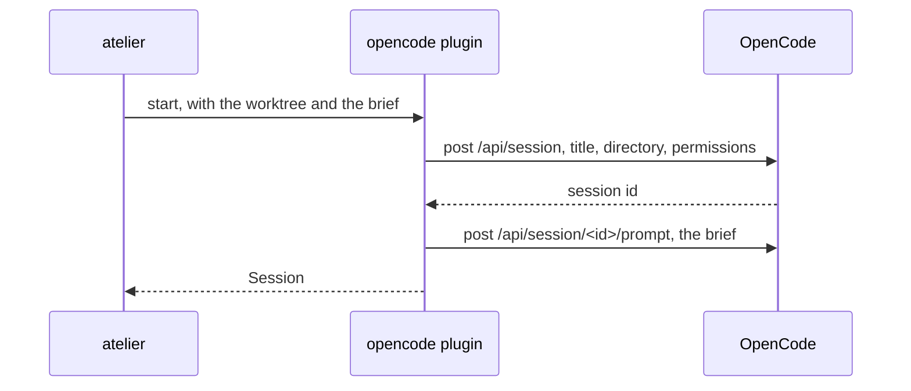

# The `opencode` plugin

Each builder is an ordinary OpenCode session: started by atelier in its
worktree, open in the TUI to watch or talk to, and refusing what its brief
denies without asking anyone. As the agent it offers pipelines the
`opencode.session` kind of step, or `agent.session` in a project whose agent
is OpenCode.



| File             | Holds                                                                       |
| ---------------- | --------------------------------------------------------------------------- |
| `lib.rs`         | `OpenCode`, and `Plugin`: registers the agent and its kind of step          |
| `steps.rs`       | The agent's kind of step, `session`, with its prompt or the builder's brief |
| `session.rs`     | Starting a session with its brief, telling it, and interrupting it          |
| `permissions.rs` | The brief's denials as the session's permission rules                       |
| `api.rs`         | `opencode api` with a 30-second deadline; 4xx permanent, else transient     |

```rust
let opencode = OpenCode::new();

let session = opencode.start(&worktree, &brief)?;
// → Session { id: "ses_…", title: "#12 Fix the dead link" }

opencode.tell(&session, "Every check passed on your pull request. …")?;

opencode.interrupt(&session)?;
```

- **Permissions**: its tools allowed; every `git push` denied, then a push to
  its own branch allowed; the brief's denied commands after that, so they win;
  the question tool denied, so it writes on the pull request instead of
  waiting. The last matching rule wins.
- **Starting again** continues the worktree's session with the brief's
  title, other than the issue's last builder, and briefs it only if it never
  was: a daemon stopped in the middle of a start leaves one builder.
- **A failed prompt** deletes the session, so no idle builder is left.
- **Telling** prompts the session, and an idle one starts a turn: atelier
  wakes the builder this way when every check passed.
- **Interrupting** an idle session succeeds, and so does interrupting or
  telling one that is gone: no builder is left to stop or tell.
