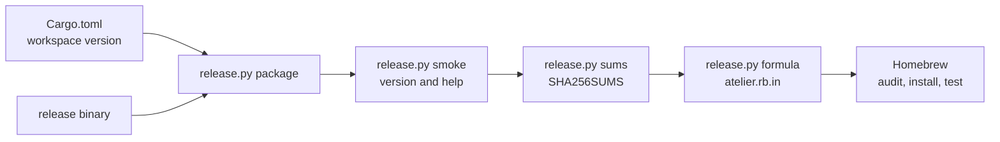

# Release tooling

The standard-library-only Python tooling builds the installable archive, runs
its binary and renders the formula from the published checksums. It requires
Python 3.13 or later; CI pins 3.13.



| File              | Holds                                                              |
| ----------------- | ------------------------------------------------------------------ |
| `release.py`      | Archive layout, size limits, checksums, formula and smoke commands |
| `atelier.rb.in`   | The formula and keep-alive service definition                      |
| `test_release.py` | Real archives and subprocess contract tests, without network       |

## Build and smoke-test

```sh
cargo build --release --locked -p atelier-cli

python3 scripts/release.py package \
  --target darwin-arm64 --binary target/release/atelier

python3 scripts/release.py smoke dist/atelier-*.tar.gz
# ...: packaged version and help passed
```

Targets are `darwin-arm64`, `linux-arm64` and `linux-x64`. Linux uses a
static musl binary. An archive holds exactly `bin/atelier` and
`share/atelier/LICENSE`. Each file is nonempty, regular and at most 128 MiB.
The smoke test refuses links, unexpected paths and extra members, then executes
`--version` and `--help` with a ten-second deadline each.

## Publish the formula

The release workflow gathers all three archives in `dist/`. The formula
requires exactly those three checksums and rejects ambiguous input.

```sh
python3 scripts/release.py sums dist

python3 scripts/release.py formula 0.1.0-rc.1 dist/SHA256SUMS \
  --out /path/to/homebrew-taps/Formula/atelier.rb
```

The formula's service runs `atelier daemon` with `keep_alive true` and
Homebrew's standard service PATH. The daemon is planned for slice 1. Slice 0's
formula tells the user not to start the service.

## Verify

```sh
uvx ruff@0.17.4 format --check scripts
uvx ruff@0.17.4 check scripts
python3 -m unittest discover -s scripts -v
```

Tests verify archive contents and modes, SHA-256 values, rejected inputs, the
formula's platform blocks and service, and the smoke test's real process
boundary. The package CI job runs the packaged Rust binary on Linux and macOS.
